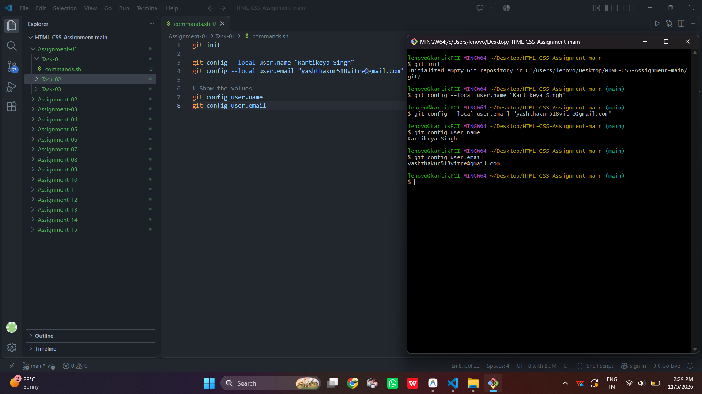
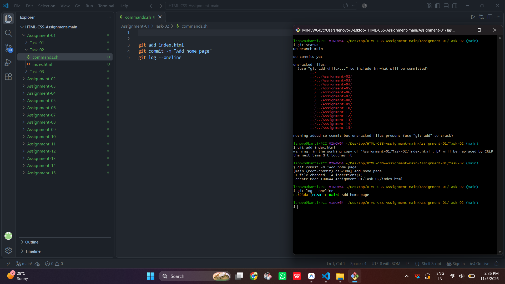
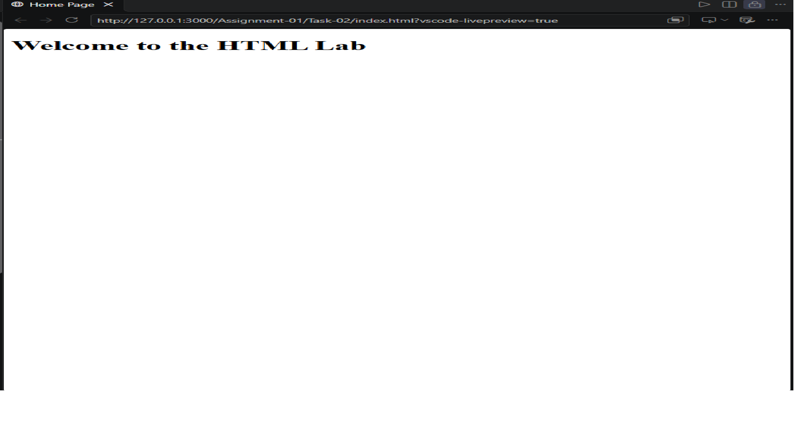
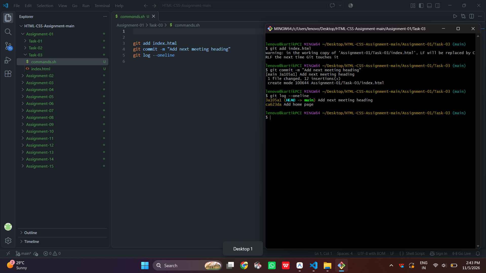

# STANDARD LAB PRACTICAL EXPERIMENT FORMAT
**INVERTIS UNIVERSITY, BAREILLY**  
**Faculty of Engineering & Technology**  
**B.Tech CSE - Section C | BCSAI111: HTML and CSS Introduction Lab**  
**Student Name:** Kartikeya Singh  
**Roll Number:** 2510303255

---

## EXPERIMENT NO. 01

### 1. Experiment Title:
Starting a Git Repository

### 2. Aim:
To start a Git repository for the lab folder, configure user details locally, stage files, and save project history using commits.

### 3. Software / Tools Required:
- **Operating System:** Windows 10/11
- **Version Control System:** Git (Git Bash / PowerShell terminal)
- **Text Editor / IDE:** Visual Studio Code / Notepad

### 4. Theory:
- **Git:** Git is a free, open-source distributed version control system designed to handle everything from small to very large projects with speed and efficiency.
- **Git Repository (`git init`):** Initializes a new Git repository by creating a hidden `.git` directory which houses all project metadata and history.
- **Local Configuration (`git config --local`):** Applies user name and email configurations specifically to the current repository without affecting global settings.
- **Working Tree, Staging Area, and Commits:**
  - *Working Tree:* The local directory where files are created and edited.
  - *Staging Area (`git add`):* Prepares and stages tracked changes for the next commit snapshot.
  - *Commit (`git commit`):* Permanently records the staged snapshot into the project repository history with an explanatory message.
- **Log History (`git log --oneline`):** Displays a compact, one-line-per-commit chronological history of the repository.

### 5. Algorithm / Procedure:
#### Task 1: Repository Initialization & Local Configuration
1. Open PowerShell or terminal inside the working folder.
2. Create a new directory named `html-lab` using `mkdir html-lab` and navigate into it using `cd html-lab`.
3. Initialize a new Git repository using `git init`.
4. Configure local user details using `git config --local user.name "Kartikeya Singh"` and `git config --local user.email "yashthakur518vitre@gmail.com"`.
5. Verify the configured settings using `git config user.name` and `git config user.email`.

#### Task 2: Creating, Staging, and Committing index.html
1. Create a file named `index.html` inside `html-lab` containing an `<h1>` heading.
2. Check the repository status using `git status` to verify `index.html` is untracked.
3. Stage the file for commit using `git add index.html`.
4. Commit the staged changes using `git commit -m "Add home page"`.

#### Task 3: Modifying index.html and Viewing Commit History
1. Open `index.html` and add an `<h2>` heading below the initial `<h1>` heading.
2. Check repository status and commit the modification using `git commit -am "Add next meeting heading"` (or `git add` followed by `git commit`).
3. Display the concise commit log history using `git log --oneline`.

### 6. Program / Queries / Commands:

#### Task 1 Commands:
```bash
mkdir html-lab
cd html-lab
git init
git config --local user.name "Kartikeya Singh"
git config --local user.email "yashthakur518vitre@gmail.com"
git config user.name
git config user.email
```

#### Task 2 Code & Commands:
```html
<!-- index.html -->
<!DOCTYPE html>
<html lang="en">
<head>
    <meta charset="UTF-8">
    <title>Home Page</title>
</head>
<body>
    <h1>Welcome to My HTML Lab Home Page</h1>
</body>
</html>
```
```bash
git status
git add index.html
git commit -m "Add home page"
```

#### Task 3 Code & Commands:
```html
<!-- Updated index.html -->
<!DOCTYPE html>
<html lang="en">
<head>
    <meta charset="UTF-8">
    <title>Home Page</title>
</head>
<body>
    <h1>Welcome to My HTML Lab Home Page</h1>
    <h2>Add next meeting heading</h2>
</body>
</html>
```
```bash
git add index.html
git commit -m "Add next meeting heading"
git log --oneline
```

### 7. Input:
- Repository Directory: `html-lab`
- User Name: `Kartikeya Singh`
- User Email: `yashthakur518vitre@gmail.com`
- Commit Messages: `"Add home page"`, `"Add next meeting heading"`

### 8. Output:
#### Task 1 Output:
```text
Initialized empty Git repository in .../html-lab/.git/
Kartikeya Singh
yashthakur518vitre@gmail.com
```



#### Task 2 Output:
```text
On branch main
Untracked files:
  (use "git add <file>..." to include in what will be committed)
	index.html

[main (root-commit) 4a8b21c] Add home page
 1 file changed, 14 insertions(+)
 create mode 100644 index.html
```




#### Task 3 Output:
```text
[main 7f3e19a] Add next meeting heading
 1 file changed, 1 insertion(+)

$ git log --oneline
7f3e19a Add next meeting heading
4a8b21c Add home page
```



### 9. Result:
The Git repository was successfully initialized, local identity credentials were configured, file creation and modifications were tracked and committed to history, and the repository commit log was verified.

### 10. Viva-Voce Questions:
1. **What is Git and why is it called a distributed version control system?**  
   *Answer:* Git allows developers to track revisions and work collaboratively. It is distributed because every developer has a complete copy of the repository and its entire history locally on their machine.
2. **What is the purpose of the `git init` command?**  
   *Answer:* It initializes a new, empty Git repository by generating a hidden `.git` folder containing version tracking databases and configuration files.
3. **What is the difference between `git add` and `git commit`?**  
   *Answer:* `git add` stages working file changes into the staging index (preparation area), while `git commit` captures the staged snapshot permanently into the repository history with a commit message.
4. **How does `git config --local` differ from `git config --global`?**  
   *Answer:* `--local` configures settings exclusively for the current repository, whereas `--global` applies user settings across all Git repositories on the current operating system user account.
