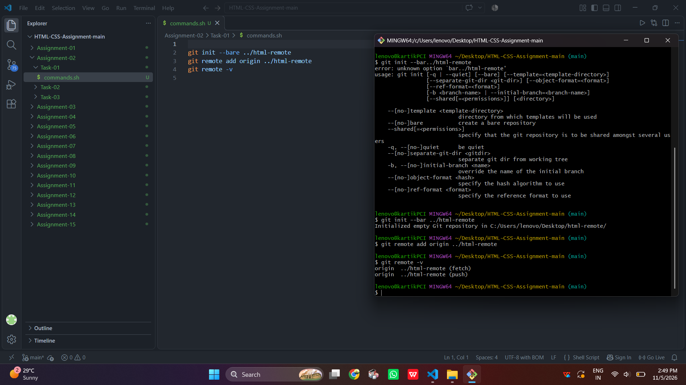
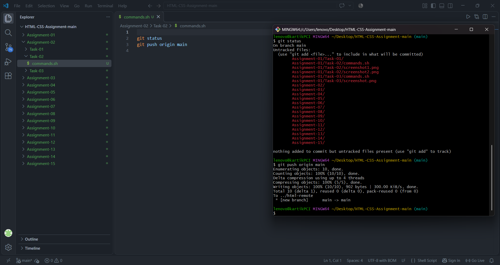
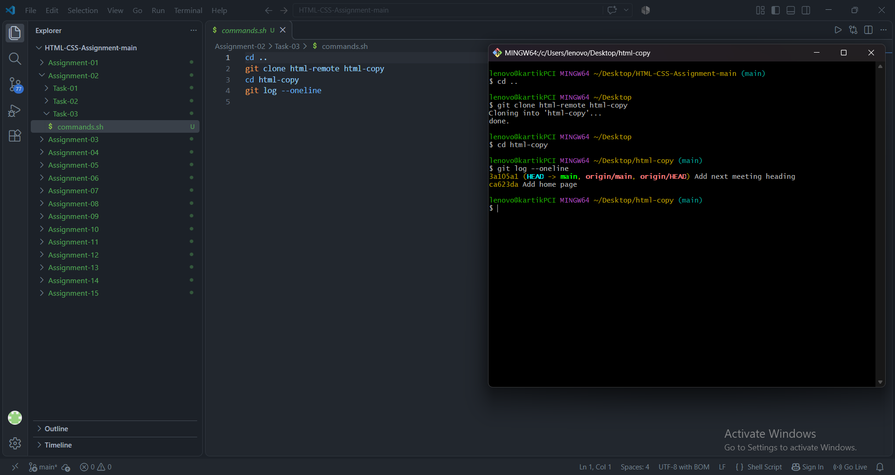

# STANDARD LAB PRACTICAL EXPERIMENT FORMAT
**INVERTIS UNIVERSITY, BAREILLY**  
**Faculty of Engineering & Technology**  
**B.Tech CSE - Section C | BCSAI111: HTML and CSS Introduction Lab**  
**Student Name:** Saiful Islam
**Roll Number:** 2510303448

---

## EXPERIMENT NO. 02

### 1. Experiment Title:
Pushing and Cloning a Repository

### 2. Aim:
To configure a bare remote repository on the local machine, push commits to the remote origin, and clone the repository into a separate folder to verify history replication.

### 3. Software / Tools Required:
- **Operating System:** Windows 10/11
- **Tools:** Git (Git Bash / PowerShell terminal)

### 4. Theory:
- **Bare Repository (`git init --bare`):** A repository created without a working directory. It contains only version history and objects, making it safe and ideal for functioning as a central remote sharing target.
- **Remote Origin (`git remote add`):** An alias or pointer named `origin` that links the local repository to a remote repository URL or directory path.
- **Pushing (`git push`):** Uploads local branch commits to the remote repository.
- **Cloning (`git clone`):** Copies an existing remote repository into a new directory, creating remote-tracking branches and checking out the default branch.

### 5. Algorithm / Procedure:
#### Task 1: Creating Bare Remote & Adding Origin
1. Open terminal inside `html-lab`.
2. Initialize an empty bare repository named `html-remote` in the parent directory using `git init --bare ../html-remote`.
3. Add the remote target as origin using `git remote add origin ../html-remote`.
4. Verify the remote configuration using `git remote -v`.

#### Task 2: Pushing Commits to Remote Origin
1. Check the active branch name with `git status` (usually `main` or `master`).
2. Push commits from the local active branch to origin using `git push origin main` (or `git push origin master`).

#### Task 3: Cloning Repository and Verifying History
1. Move up to the parent directory using `cd ..`.
2. Clone `html-remote` into a new directory named `html-copy` using `git clone html-remote html-copy`.
3. Navigate into `html-copy` using `cd html-copy`.
4. Inspect the replicated commit history using `git log --oneline`.

### 6. Program / Queries / Commands:

#### Task 1 Commands:
```bash
cd html-lab
git init --bare ../html-remote
git remote add origin ../html-remote
git remote -v
```

#### Task 2 Commands:
```bash
cd html-lab
git push origin main
```

#### Task 3 Commands:
```bash
cd ..
git clone html-remote html-copy
cd html-copy
git log --oneline
```

### 7. Input:
- Bare Repository Path: `../html-remote`
- Remote Alias: `origin`
- Target Branch: `main`
- Cloned Directory Name: `html-copy`

### 8. Output:
#### Task 1 Output:
```text
Initialized empty Git repository in .../Assignment-02/html-remote/
origin  ../html-remote (fetch)
origin  ../html-remote (push)
```



#### Task 2 Output:
```text
Enumerating objects: 6, done.
Counting objects: 100% (6/6), done.
Delta compression using up to 8 threads
Compressing objects: 100% (4/4), done.
Writing objects: 100% (6/6), 578 bytes | 578.00 KiB/s, done.
To ../html-remote
 * [new branch]      main -> main
```



#### Task 3 Output:
```text
Cloning into 'html-copy'...
done.

$ git log --oneline
7f3e19a Add next meeting heading
4a8b21c Add home page
```



### 9. Result:
The bare remote repository was successfully created and linked; local commits were pushed to the remote branch; and the entire repository was cloned into a new directory with complete history preserved.

### 10. Viva-Voce Questions:
1. **What is a bare Git repository and where is it used?**  
   *Answer:* A bare repository has no working directory; it stores only Git database files. It is used as a central hub (server/remote) where developers push and pull code.
2. **What is the function of `git remote -v`?**  
   *Answer:* It lists all configured remote names along with their respective fetch and push URLs or folder paths.
3. **What is the difference between `git push` and `git pull`?**  
   *Answer:* `git push` transmits local commits to a remote repository, while `git pull` fetches changes from the remote repository and merges them into the current local branch.
4. **Does `git clone` download the full commit history?**  
   *Answer:* Yes, `git clone` copies the entire commit history, all branches, and all files from the remote repository.
