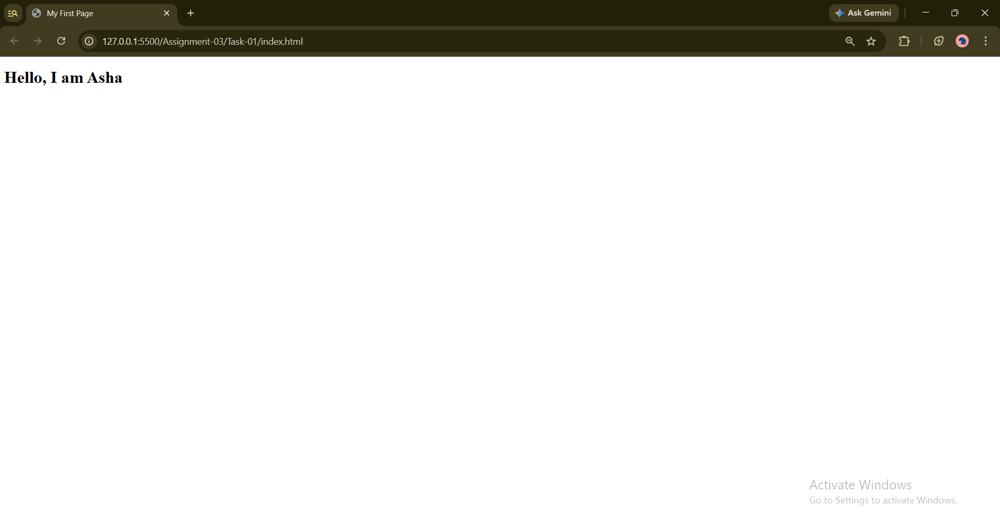
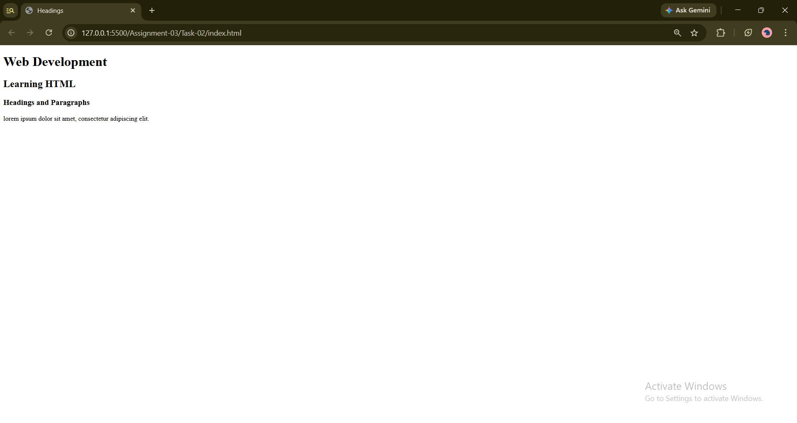
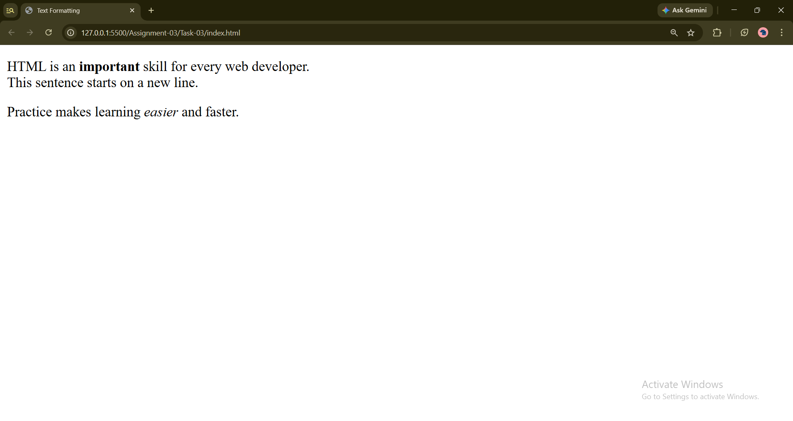

# STANDARD LAB PRACTICAL EXPERIMENT FORMAT
**INVERTIS UNIVERSITY, BAREILLY**  
**Faculty of Engineering & Technology**  
**B.Tech CSE - Section C | BCSAI111: HTML and CSS Introduction Lab**  
**Student Name:**  Saiful Islam
**Roll Number:** 2510303448

---

## EXPERIMENT NO. 03

### 1. Experiment Title:
Your First HTML Page

### 2. Aim:
To understand basic HTML document structure, implement headings across various hierarchy levels, create paragraphs, and format text using strong, emphasis, and line breaks.

### 3. Software / Tools Required:
- **Web Browser:** Google Chrome / Microsoft Edge / Mozilla Firefox
- **Text Editor:** Visual Studio Code / Notepad

### 4. Theory:
- **HTML (HyperText Markup Language):** The standard markup language for documents designed to be displayed in a web browser.
- **Document Structure:** Every standard HTML5 document begins with `<!DOCTYPE html>`, followed by the root `<html>`, head metadata section `<head>`, and the visual body section `<body>`.
- **Headings (`<h1>` to `<h6>`):** Heading tags define the visual and semantic hierarchy of content. `<h1>` represents the highest and most important heading level.
- **Paragraphs (`<p>`):** Used to represent blocks of continuous text.
- **Inline Text Formatting:**
  - `<strong>`: Represents strong importance or urgency; rendered bold by default.
  - `<em>`: Represents emphasized stress; rendered in italic by default.
  - `<br>`: Produces a line break without beginning a new paragraph.

### 5. Algorithm / Procedure:
#### Task 1: Basic Page Structure & Title (`first.html`)
1. Create `first.html`.
2. Add the `<!DOCTYPE html>`, `<html>`, `<head>`, and `<body>` tags.
3. Inside `<head>`, set the title to `My First Page`.
4. Inside `<body>`, add an `<h1>` heading with text `Hello, I am Asha.`.
5. Open the file in a browser and verify the browser tab title and heading.

#### Task 2: Heading Hierarchy (`headings.html`)
1. Create `headings.html`.
2. In `<body>`, insert an `<h1>`, `<h2>`, and `<h3>` heading with descriptive text.
3. Add a `<p>` element explaining the concept of web headings.
4. Save and open in a browser to observe decreasing heading font sizes.

#### Task 3: Text Formatting & Breaks (`text-format.html`)
1. Create `text-format.html`.
2. Add two paragraphs of text.
3. Apply `<strong>` around one chosen word in the first paragraph.
4. Add a `<br>` tag to create a forced line break within the first paragraph.
5. Apply `<em>` around one word in the second paragraph.
6. Open the page in a browser to verify bold, italic, and broken line renderings.

### 6. Program / Queries / Commands:

#### Task 1: `first.html`
```html
<!DOCTYPE html>
<html lang="en">
<head>
    <meta charset="UTF-8">
    <meta name="viewport" content="width=device-width, initial-scale=1.0">
    <title>My First Page</title>
</head>
<body>
    <h1>Hello, I am Asha.</h1>
</body>
</html>
```

#### Task 2: `headings.html`
```html
<!DOCTYPE html>
<html lang="en">
<head>
    <meta charset="UTF-8">
    <meta name="viewport" content="width=device-width, initial-scale=1.0">
    <title>HTML Headings Demonstration</title>
</head>
<body>
    <h1>Main Heading (H1) - Web Technologies Overview</h1>
    <h2>Subheading (H2) - Introduction to HTML</h2>
    <h3>Section Heading (H3) - Essential HTML Tags</h3>
    <p>HTML is the standard markup language used for creating web pages. Headings help define the structural hierarchy of web content, with H1 being the most prominent and H6 being the least.</p>
</body>
</html>
```

#### Task 3: `text-format.html`
```html
<!DOCTYPE html>
<html lang="en">
<head>
    <meta charset="UTF-8">
    <meta name="viewport" content="width=device-width, initial-scale=1.0">
    <title>Text Formatting</title>
</head>
<body>
    <p>Computer science education empowers students to solve <strong>complex</strong> real-world engineering problems.<br>It also encourages critical reasoning and lifelong learning.</p>
    <p>Developing clean web solutions requires consistent practice and <em>creative</em> problem-solving skills.</p>
</body>
</html>
```

### 7. Input:
- Task 1 Heading: `Hello, I am Asha.`
- Task 2 Headings: H1, H2, H3 and paragraph text.
- Task 3 Text: Formatted text with `<strong>`, `<em>`, and `<br>`.

### 8. Output:
- **Task 1:** Browser tab displays "My First Page" with a prominent top heading: "Hello, I am Asha."

  

- **Task 2:** Three descending headings (H1 > H2 > H3) followed by paragraph text.

  

- **Task 3:** Two paragraphs where one word appears bold (**complex**), a line break occurs mid-paragraph, and one word appears italic (*creative*).

  


### 9. Result:
The first HTML pages were successfully developed and validated in a browser, proving comprehension of document structure, heading hierarchy, and text formatting tags.

### 10. Viva-Voce Questions:
1. **What is the significance of the `<!DOCTYPE html>` declaration?**  
   *Answer:* It informs the web browser that the document is written in HTML5 standard, ensuring standard rendering mode.
2. **What is the difference between `<b>` and `<strong>`?**  
   *Answer:* `<b>` only visually bolds text without semantic meaning, whereas `<strong>` indicates strong importance or urgency for both visual users and screen readers.
3. **What is an empty or self-closing element in HTML? Give an example.**  
   *Answer:* An empty element has no content and no closing tag. Example: `<br>` and `<hr>`.
4. **How many heading levels does HTML support?**  
   *Answer:* HTML supports six levels of headings, ranging from `<h1>` (highest level) to `<h6>` (lowest level).
