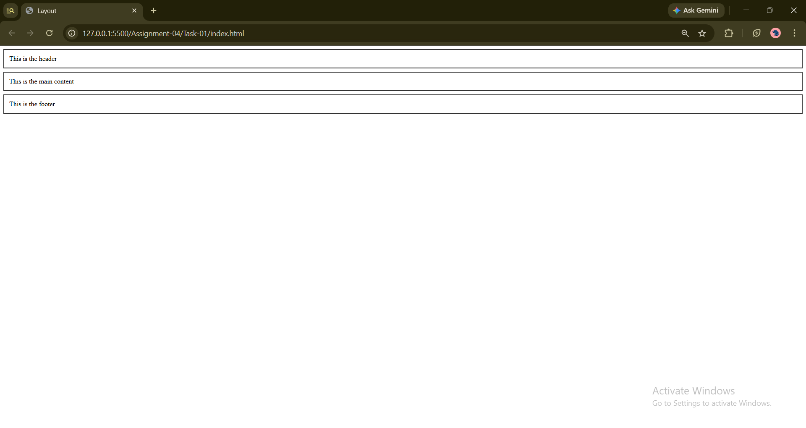
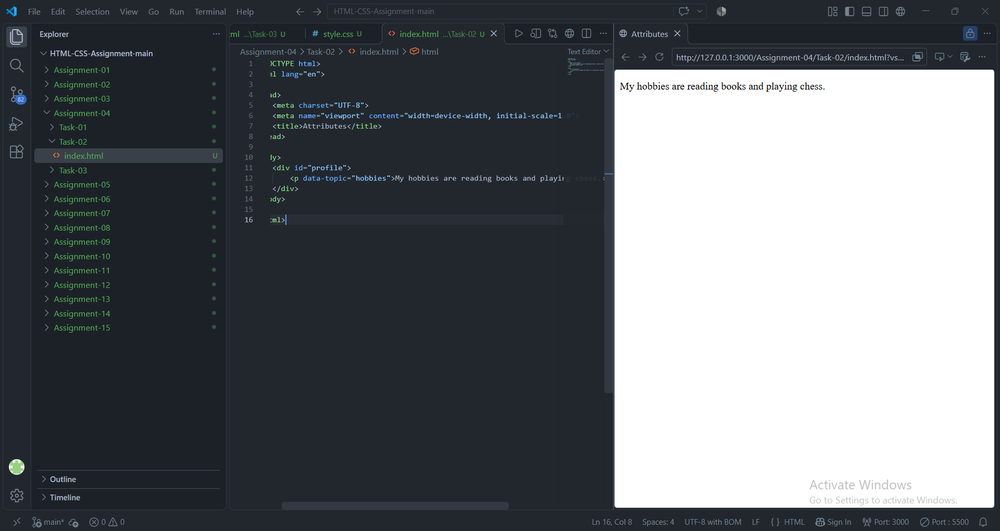
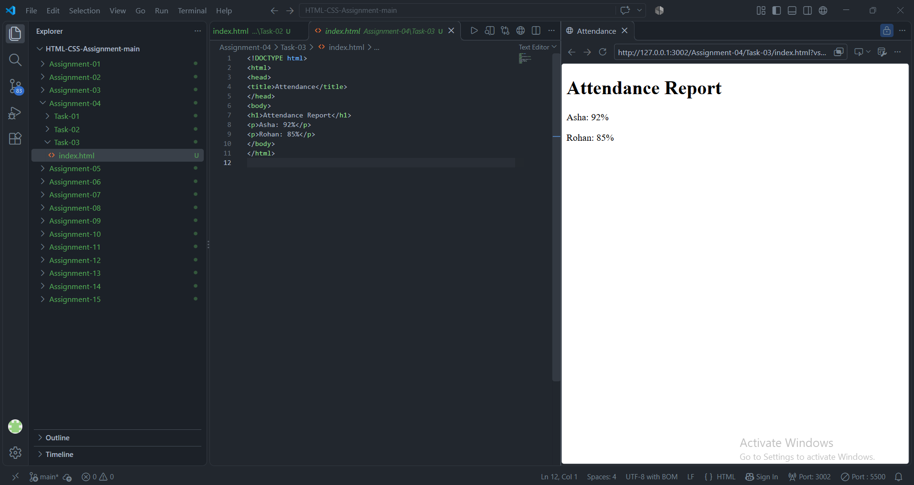

# STANDARD LAB PRACTICAL EXPERIMENT FORMAT
**INVERTIS UNIVERSITY, BAREILLY**  
**Faculty of Engineering & Technology**  
**B.Tech CSE - Section C | BCSAI111: HTML and CSS Introduction Lab**  
**Student Name:**  Saiful Islam
**Roll Number:** 2510303448

---

## EXPERIMENT NO. 04

### 1. Experiment Title:
Divs, Attributes and a Small Fix

### 2. Aim:
To group layout sections using `<div>` elements, attach custom `data-*` attributes for metadata, and diagnose and repair syntax errors in broken HTML code.

### 3. Software / Tools Required:
- **Web Browser:** Google Chrome / Mozilla Firefox / Microsoft Edge
- **Text Editor:** Visual Studio Code / Notepad

### 4. Theory:
- **The `<div>` Tag:** A generic block-level container element used to group HTML elements for structural layout and styling purposes.
- **Classes and IDs:**
  - *Class (`class="..."`):* Used to group multiple elements for shared styling or behavior.
  - *ID (`id="..."`):* A unique identifier assigned to a single element on a web page.
- **Custom Data Attributes (`data-*`):** HTML5 attributes that allow developers to embed custom data directly on elements without affecting visual display or standard semantics.
- **HTML Syntax Debugging:** Valid HTML requires every tag to be properly opened, nested, and closed. Unclosed tags lead to unpredictable rendering issues across browsers.

### 5. Algorithm / Procedure:
#### Task 1: Div Layout (`layout.html`)
1. Create `layout.html`.
2. Construct three `<div>` blocks assigned classes `header`, `main`, and `footer`.
3. Add text and headings to each block.
4. Add basic CSS styling to visually distinguish the layout sections.

#### Task 2: Custom Data Attributes (`attributes.html`)
1. Create `attributes.html`.
2. Create a `<div>` with `id="profile"`.
3. Inside the div, add a `<p>` tag and attach the attribute `data-topic="hobbies"`.
4. Add description text inside the paragraph.
5. Inspect the element in the browser's Developer Tools to confirm the custom attribute.

#### Task 3: Fixing Broken HTML (`attendance-fixed.html`)
1. Examine the broken code:
   `<!DOCTYPE html><html><head><title>Attendance</title></head><body><h1>Attendance Report<p>Asha: 92%<p><p>Rohan: 85%</p></body></html>`
2. Identify syntax defects:
   - `<h1>` is missing its closing tag `</h1>`.
   - The first `<p>` tag has a duplicate opening `<p>` instead of a closing tag `</p>`.
3. Correct all tags, format the document with indentation, and save as `attendance-fixed.html`.

### 6. Program / Queries / Commands:

#### Task 1: `layout.html`
```html
<!DOCTYPE html>
<html lang="en">
<head>
    <meta charset="UTF-8">
    <meta name="viewport" content="width=device-width, initial-scale=1.0">
    <title>Layout with Div Blocks</title>
    <style>
        .header { background-color: #2c3e50; color: #ffffff; padding: 15px; text-align: center; }
        .main { background-color: #ecf0f1; color: #333333; padding: 25px; margin: 10px 0; }
        .footer { background-color: #34495e; color: #ffffff; padding: 12px; text-align: center; }
    </style>
</head>
<body>
    <div class="header">
        <h1>Invertis University - Computer Science Department</h1>
    </div>
    <div class="main">
        <h2>HTML and CSS Introduction Lab</h2>
        <p>This section represents the main content block grouped within a div having class="main".</p>
    </div>
    <div class="footer">
        <p>&copy; 2026 Invertis University Bareilly. All rights reserved.</p>
    </div>
</body>
</html>
```

#### Task 2: `attributes.html`
```html
<!DOCTYPE html>
<html lang="en">
<head>
    <meta charset="UTF-8">
    <meta name="viewport" content="width=device-width, initial-scale=1.0">
    <title>HTML Attributes and Custom Data Attributes</title>
</head>
<body>
    <div id="profile">
        <h2>Student Profile</h2>
        <p data-topic="hobbies">My hobbies include coding web applications, reading science fiction literature, and playing chess in my free time.</p>
    </div>
</body>
</html>
```

#### Task 3: `attendance-fixed.html`
```html
<!DOCTYPE html>
<html lang="en">
<head>
    <meta charset="UTF-8">
    <meta name="viewport" content="width=device-width, initial-scale=1.0">
    <title>Attendance</title>
</head>
<body>
    <h1>Attendance Report</h1>
    <p>Asha: 92%</p>
    <p>Rohan: 85%</p>
</body>
</html>
```

### 7. Input:
- Div Classes: `header`, `main`, `footer`
- ID: `profile`
- Data Attribute: `data-topic="hobbies"`
- Attendance Data: `Asha: 92%`, `Rohan: 85%`

### 8. Output:
- **Task 1:** Visual header block on top, body main block in the middle, and footer block at the bottom.

  

- **Task 2:** Visible paragraph text; `data-topic="hobbies"` is invisibly stored in the DOM and visible via inspect element.

  

- **Task 3:** Clean, error-free attendance report with heading "Attendance Report" and two distinct lines of student percentages.

  


### 9. Result:
Page elements were grouped with styled `<div>` containers, custom data attributes were embedded, and malformed HTML syntax was successfully repaired.

### 10. Viva-Voce Questions:
1. **What is the difference between a block-level and an inline element?**  
   *Answer:* Block-level elements (like `<div>`, `<p>`) start on a new line and stretch the full width available, whereas inline elements (like `<span>`, `<a>`) only take up as much width as necessary and do not cause line breaks.
2. **Can multiple elements have the same `class` or the same `id`?**  
   *Answer:* Multiple elements can share the same `class`, but an `id` must be unique to a single element within an HTML document.
3. **What is the purpose of HTML5 `data-*` attributes?**  
   *Answer:* They store private custom data on standard HTML elements that can be easily retrieved and manipulated using JavaScript and CSS without affecting rendering.
4. **Why is it essential to close all HTML tags?**  
   *Answer:* Unclosed tags cause unexpected rendering, invalid DOM tree generation, styling bleed-through, and poor accessibility parsing.
