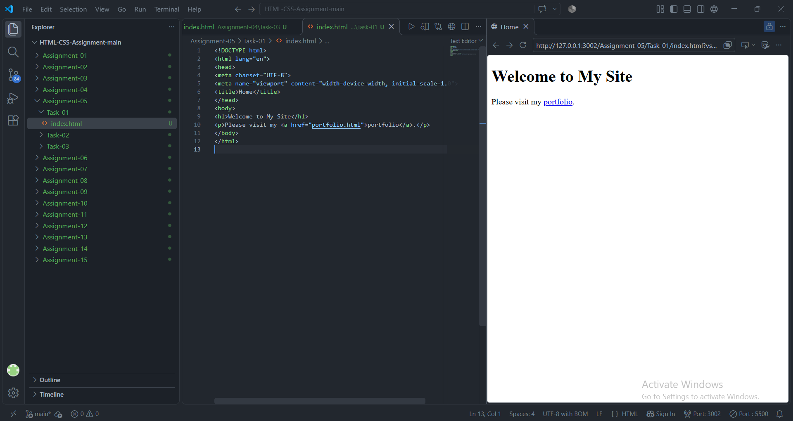
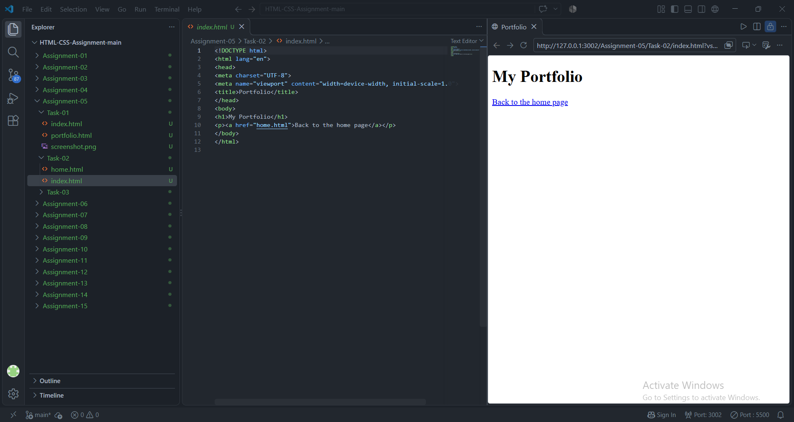
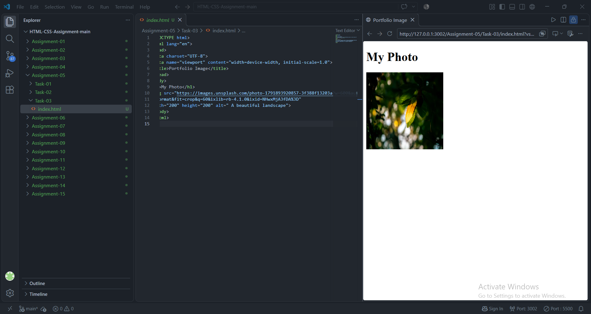

# STANDARD LAB PRACTICAL EXPERIMENT FORMAT
**INVERTIS UNIVERSITY, BAREILLY**  
**Faculty of Engineering & Technology**  
**B.Tech CSE - Section C | BCSAI111: HTML and CSS Introduction Lab**  
**Student Name:**  Saiful Islam 
**Roll Number:** 2510303448

---

## EXPERIMENT NO. 05

### 1. Experiment Title:
Links and Images

### 2. Aim:
To link multiple web pages together using hyperlinks and embed images with dimensions and alternative text.

### 3. Software / Tools Required:
- **Web Browser:** Google Chrome / Microsoft Edge / Mozilla Firefox
- **Text Editor:** Visual Studio Code / Notepad
- **Image Asset:** JPEG/PNG graphic file

### 4. Theory:
- **Hyperlinks (`<a>` tag):** Links are defined with the anchor tag `<a>`. The `href` attribute specifies the destination URL or file path.
- **Relative vs Absolute URLs:**
  - *Relative URL:* Points to a file relative to the current page (e.g., `portfolio.html`).
  - *Absolute URL:* Points to a complete web address including protocol (e.g., `https://example.com`).
- **Images (`` tag):** An empty tag used to embed images. Key attributes include:
  - `src`: Path to the image file.
  - `alt`: Alternative text displayed when the image fails to load and read by screen readers for accessibility.
  - `width` and `height`: Specify explicit dimensions to reserve layout space and prevent cumulative layout shift.

### 5. Algorithm / Procedure:
#### Task 1: Linking Home to Portfolio (`home.html`)
1. Create `home.html`.
2. Add an `<h1>` heading `Welcome to My Site`.
3. Add a paragraph containing a link `<a href="portfolio.html">portfolio</a>`.
4. Ensure `portfolio.html` exists in the same folder so clicking navigates properly.

#### Task 2: Linking Portfolio Back to Home (`portfolio.html`)
1. Create `portfolio.html`.
2. Add an `<h1>` heading `My Portfolio Showcase`.
3. Add a return hyperlink `<a href="home.html">Return to Home Page</a>`.
4. Test reciprocal navigation back and forth in the browser.

#### Task 3: Embedding an Image (`portfolio-image.html`)
1. Create an `images` subfolder and place a 200x200 image (`profile.jpg`) inside it.
2. Create `portfolio-image.html`.
3. Insert an `` tag pointing to `images/profile.jpg`.
4. Set `width="200"`, `height="200"`, and provide descriptive `alt` text.
5. Verify image rendering and verify that alt text displays if the file path is changed.

### 6. Program / Queries / Commands:

#### Task 1: `home.html`
```html
<!DOCTYPE html>
<html lang="en">
<head>
    <meta charset="UTF-8">
    <meta name="viewport" content="width=device-width, initial-scale=1.0">
    <title>Home - Welcome to My Site</title>
</head>
<body>
    <h1>Welcome to My Site</h1>
    <p>Explore my personal work and student projects on my <a href="portfolio.html">portfolio</a>.</p>
</body>
</html>
```

#### Task 2: `portfolio.html`
```html
<!DOCTYPE html>
<html lang="en">
<head>
    <meta charset="UTF-8">
    <meta name="viewport" content="width=device-width, initial-scale=1.0">
    <title>Portfolio</title>
</head>
<body>
    <h1>My Portfolio Showcase</h1>
    <p><a href="home.html">Return to Home Page</a></p>
</body>
</html>
```

#### Task 3: `portfolio-image.html`
```html
<!DOCTYPE html>
<html lang="en">
<head>
    <meta charset="UTF-8">
    <meta name="viewport" content="width=device-width, initial-scale=1.0">
    <title>Portfolio Image</title>
</head>
<body>
    <h1>Student Profile Picture</h1>
    
</body>
</html>
```

### 7. Input:
- Links: `portfolio.html`, `home.html`
- Image Source: `images/profile.jpg`
- Image Dimensions: Width = 200px, Height = 200px
- Alt Text: `" A beautiful landscape"`

### 8. Output:
- **Task 1:** "Welcome to My Site" with a clickable link word "portfolio" opening `portfolio.html`.

  

- **Task 2:** "My Portfolio Showcase" with a clickable link returning to `home.html`.

  

- **Task 3:** A 200x200 pixel profile picture rendered neatly beneath the heading; fallback text displays if the image is missing.

  


### 9. Result:
Bidirectional hyperlinks were successfully constructed between web pages, and an image asset was embedded with defined dimensions and accessible alt text.

### 10. Viva-Voce Questions:
1. **Why is the `alt` attribute mandatory for images?**  
   *Answer:* It provides textual context when the image fails to load and is read by screen readers for visually impaired users.
2. **How can a link be made to open in a new browser tab?**  
   *Answer:* By setting the attribute `target="_blank"` on the anchor element: `<a href="..." target="_blank">`.
3. **What is the difference between relative and absolute file paths?**  
   *Answer:* Relative paths reference locations starting from the current file (`images/pic.jpg`), while absolute paths reference a complete URL from the root or domain (`https://site.com/pic.jpg`).
4. **Why should width and height attributes be specified for images in HTML?**  
   *Answer:* Specifying explicit dimensions allows the browser to reserve the exact layout space before the image is downloaded, preventing page layout shifts.
