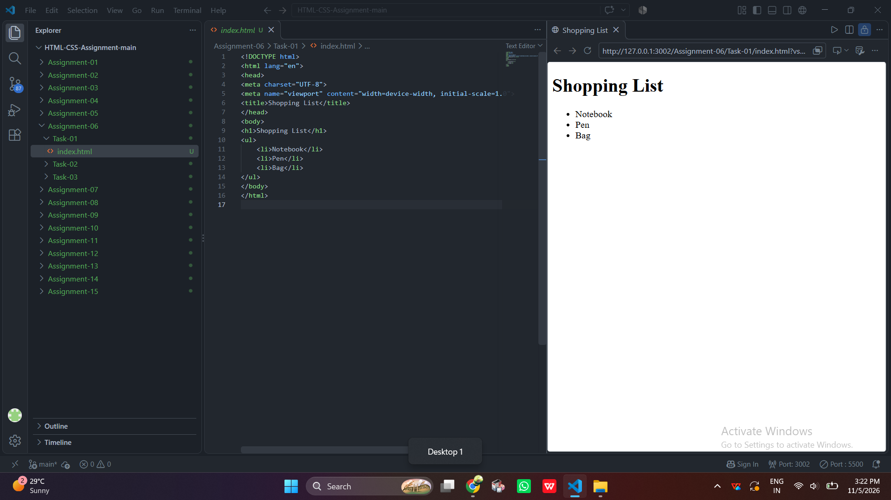
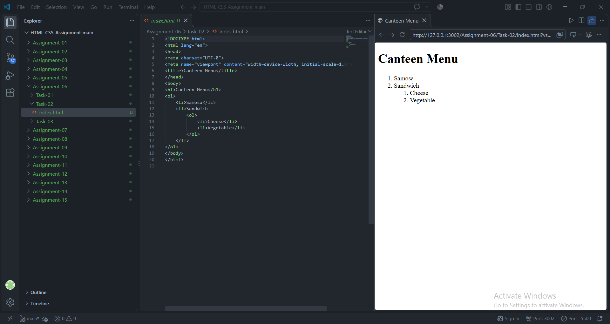
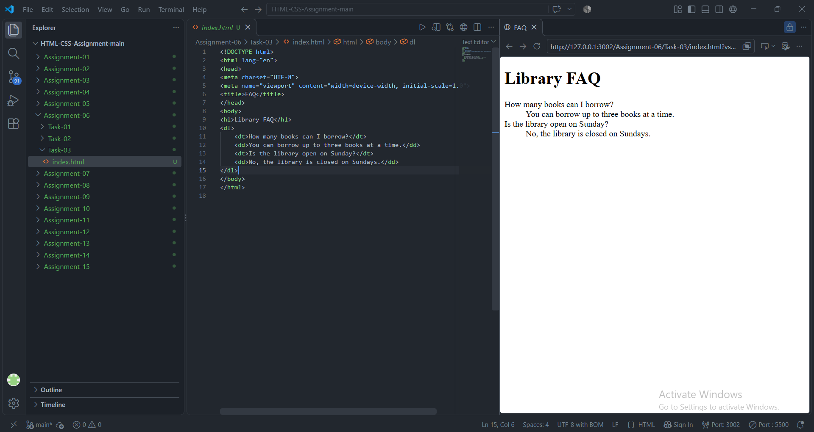

# STANDARD LAB PRACTICAL EXPERIMENT FORMAT
**INVERTIS UNIVERSITY, BAREILLY**  
**Faculty of Engineering & Technology**  
**B.Tech CSE - Section C | BCSAI111: HTML and CSS Introduction Lab**  
**Student Name:**  Saiful Islam
**Roll Number:** 2510303448

---

## EXPERIMENT NO. 06

### 1. Experiment Title:
Types of HTML Lists

### 2. Aim:
To implement different types of HTML lists: an unordered (bulleted) list, an ordered (numbered) list with nesting, and a description (definition) list.

### 3. Software / Tools Required:
- **Web Browser:** Google Chrome / Microsoft Edge / Mozilla Firefox
- **Text Editor:** Visual Studio Code / Notepad

### 4. Theory:
- **Unordered List (`<ul>`):** Displays items using bullet markers where item order does not convey sequential significance. Each item is enclosed within `<li>`.
- **Ordered List (`<ol>`):** Displays items in numerical or alphabetical sequence.
- **Nested List:** A list placed inside a parent `<li>` element to depict subcategories or hierarchical relationships.
- **Description List (`<dl>`):** Groups term and description pairs. It uses:
  - `<dt>`: Defines the term/name/question.
  - `<dd>`: Describes or answers the term.

### 5. Algorithm / Procedure:
#### Task 1: Unordered List (`shopping-list.html`)
1. Create `shopping-list.html`.
2. Add an `<h1>` heading `Shopping List`.
3. Open a `<ul>` element and add three `<li>` elements: `Notebook`, `Pen`, and `Bag`.
4. Close `</ul>` and preview in browser.

#### Task 2: Nested Ordered List (`canteen-menu.html`)
1. Create `canteen-menu.html`.
2. Add an `<h1>` heading `Canteen Menu`.
3. Create an `<ol>` list with items `Samosa` and `Sandwich`.
4. Inside the `Sandwich` `<li>`, insert a nested `<ol>` with items `Cheese` and `Vegetable`.
5. Verify multi-level numbered ordering in the browser.

#### Task 3: Description List (`faq.html`)
1. Create `faq.html`.
2. Add an `<h1>` heading `Library FAQ`.
3. Create a `<dl>` element.
4. Add `<dt>` for "How many books can I borrow?" and `<dd>` for its answer.
5. Add `<dt>` for "Is the library open on Sunday?" and `<dd>` for its answer.
6. Verify terms and indented description formatting.

### 6. Program / Queries / Commands:

#### Task 1: `shopping-list.html`
```html
<!DOCTYPE html>
<html lang="en">
<head>
    <meta charset="UTF-8">
    <meta name="viewport" content="width=device-width, initial-scale=1.0">
    <title>Shopping List</title>
</head>
<body>
    <h1>Shopping List</h1>
    <ul>
        <li>Notebook</li>
        <li>Pen</li>
        <li>Bag</li>
    </ul>
</body>
</html>
```

#### Task 2: `canteen-menu.html`
```html
<!DOCTYPE html>
<html lang="en">
<head>
    <meta charset="UTF-8">
    <meta name="viewport" content="width=device-width, initial-scale=1.0">
    <title>Canteen Menu</title>
</head>
<body>
    <h1>Canteen Menu</h1>
    <ol>
        <li>Samosa</li>
        <li>
            Sandwich
            <ol>
                <li>Cheese</li>
                <li>Vegetable</li>
            </ol>
        </li>
    </ol>
</body>
</html>
```

#### Task 3: `faq.html`
```html
<!DOCTYPE html>
<html lang="en">
<head>
    <meta charset="UTF-8">
    <meta name="viewport" content="width=device-width, initial-scale=1.0">
    <title>Frequently Asked Questions (FAQ)</title>
</head>
<body>
    <h1>Library FAQ</h1>
    <dl>
        <dt><strong>How many books can I borrow?</strong></dt>
        <dd>Students may borrow up to 4 books simultaneously for a duration of 14 calendar days.</dd>

        <dt><strong>Is the library open on Sunday?</strong></dt>
        <dd>No, the university central library remains closed on Sundays and national public holidays.</dd>
    </dl>
</body>
</html>
```

### 7. Input:
- Shopping items: Notebook, Pen, Bag
- Menu items: Samosa, Sandwich (Cheese, Vegetable)
- FAQ entries: Library book borrow limit, Sunday timings

### 8. Output:
- **Task 1:** 3 bullet points showing Notebook, Pen, Bag.

  

- **Task 2:** Numbered items `1. Samosa` and `2. Sandwich` with sub-numbered items `1. Cheese` and `2. Vegetable` indented underneath.

  

- **Task 3:** Terms followed by slightly indented answer definitions.

  


### 9. Result:
All three standard HTML list types (unordered, ordered with nesting, and description lists) were successfully created and formatted.

### 10. Viva-Voce Questions:
1. **Name the three types of lists supported in HTML.**  
   *Answer:* Unordered list (`<ul>`), Ordered list (`<ol>`), and Description list (`<dl>`).
2. **How do you nest an ordered list inside an unordered list?**  
   *Answer:* Place the `<ol>` directly inside an `<li>` element of the parent `<ul>`.
3. **What is the default bullet style for `<ul>` and how can it be changed?**  
   *Answer:* The default is `disc`. It can be modified using the CSS `list-style-type` property (e.g. `circle`, `square`, `none`).
4. **What are `<dt>` and `<dd>` elements used for in a description list?**  
   *Answer:* `<dt>` specifies the definition term or question, while `<dd>` specifies the definition description or answer.
