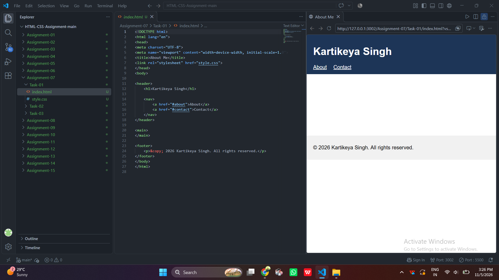
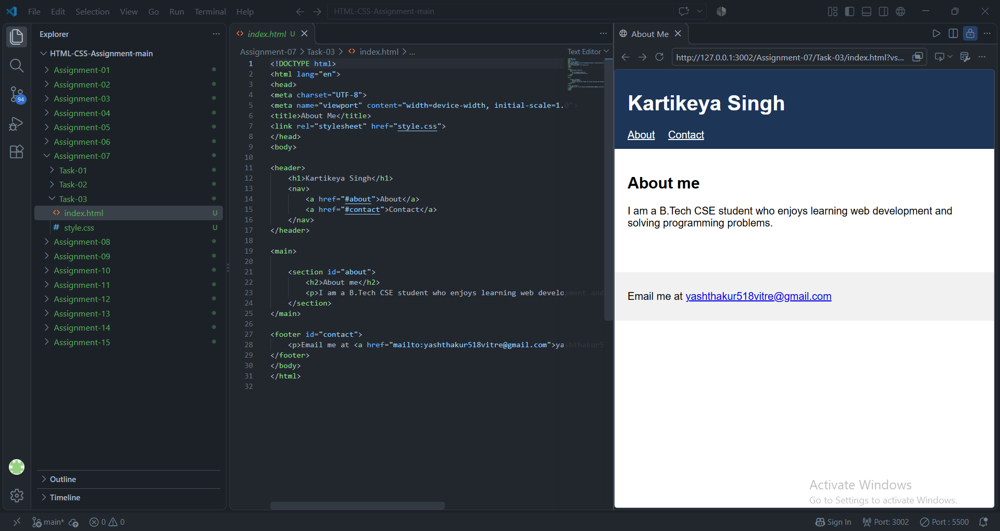

# STANDARD LAB PRACTICAL EXPERIMENT FORMAT
**INVERTIS UNIVERSITY, BAREILLY**  
**Faculty of Engineering & Technology**  
**B.Tech CSE - Section C | BCSAI111: HTML and CSS Introduction Lab**  
**Student Name:** Kartikeya Singh  
**Roll Number:** 2510303255

---

## EXPERIMENT NO. 07

### 1. Experiment Title:
About Me Page

### 2. Aim:
To construct an About Me webpage using semantic HTML5 elements (`<header>`, `<nav>`, `<main>`, `<section>`, `<footer>`), implement intra-page anchor navigation, and configure an email link using the `mailto:` scheme.

### 3. Software / Tools Required:
- **Web Browser:** Google Chrome / Microsoft Edge / Mozilla Firefox
- **Text Editor:** Visual Studio Code / Notepad

### 4. Theory:
- **Semantic HTML5:** Semantic elements clearly describe their meaning to both the browser and the developer (e.g. `<header>`, `<nav>`, `<main>`, `<section>`, `<footer>`), enhancing accessibility and SEO.
- **`<nav>`:** Represents a section of navigation links.
- **Internal Fragment Links (`#id`):** Hyperlinks that jump directly to a specific section on the same page by referencing the target element's `id` attribute.
- **Email Links (`mailto:`):** Protocol handler that instructs the browser to open the user's default email client with a pre-filled recipient address.

### 5. Algorithm / Procedure:
#### Task 1: Semantic Shell & Navigation (`about-me.html`)
1. Create `about-me.html`.
2. Add `<header>` containing an `<h1>` with student name `Kartikeya Singh` and a `<nav>` with links to `#about` and `#contact`.
3. Add empty `<main>` and `<footer>` containers.

#### Task 2: Adding the About Section
1. Inside `<main>`, create a `<section>` tag with `id="about"`.
2. Add an `<h2>` heading `About me`.
3. Add a descriptive paragraph detailing academic branch, year, and interests.

#### Task 3: Adding Contact Footer & Mailto Link
1. Inside `<footer>`, assign `id="contact"`.
2. Add a paragraph containing a clickable mailto link: `<a href="mailto:yashthakur518vitre@gmail.com">...</a>`.
3. Save and test navigation jumping and mail client launch.

### 6. Program / Queries / Commands:

#### Task 1, 2, 3: Progressive `about-me.html` (Complete Version)
```html
<!DOCTYPE html>
<html lang="en">
<head>
    <meta charset="UTF-8">
    <meta name="viewport" content="width=device-width, initial-scale=1.0">
    <title>About Me - Complete</title>
</head>
<body>
    <header>
        <h1>Kartikeya Singh</h1>
        <nav>
            <a href="#about">About</a> |
            <a href="#contact">Contact</a>
        </nav>
    </header>

    <main>
        <section id="about">
            <h2>About me</h2>
            <p>I am a second-year B.Tech Computer Science and Engineering student at Invertis University, Bareilly. I am deeply interested in front-end web development, clean coding practices, and user interface design.</p>
        </section>
    </main>

    <footer id="contact">
        <p>Email me at: <a href="mailto:yashthakur518vitre@gmail.com">yashthakur518vitre@gmail.com</a></p>
    </footer>
</body>
</html>
```

### 7. Input:
- Student Name: Kartikeya Singh
- Target IDs: `#about`, `#contact`
- Email Address: yashthakur518vitre@gmail.com

### 8. Output:
- **Task 1:** Name heading with top navigation links; blank content below.

  

- **Task 2:** Middle about section populated with heading and bio.

  

- **Task 3:** Complete webpage where clicking "About" scrolls to bio, and clicking "Contact" jumps to footer email link.

  


### 9. Result:
An About Me page was built adhering to HTML5 semantic standards, featuring intra-page bookmark navigation and an active mailto contact link.

### 10. Viva-Voce Questions:
1. **Why are semantic tags preferred over generic `<div>` tags?**  
   *Answer:* Semantic tags provide meaningful structure, improve search engine indexing (SEO), and assist assistive screen readers for accessibility.
2. **How does an internal page anchor link work in HTML?**  
   *Answer:* The `href` attribute uses a hash symbol followed by the target element's ID (e.g. `<a href="#contact">`), scrolling the browser directly to `<footer id="contact">`.
3. **What is the function of the `mailto:` URL scheme?**  
   *Answer:* It triggers the operating system's default email client, opening a compose window with the destination email address populated.
4. **Can a webpage have multiple `<section>` and `<header>` tags?**  
   *Answer:* Yes, `<header>` and `<section>` tags can represent headers and sections of the document or of specific articles and components.
