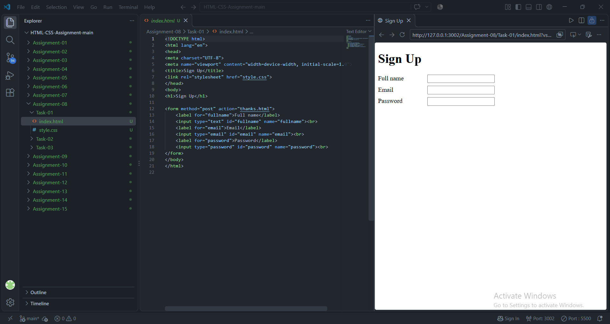
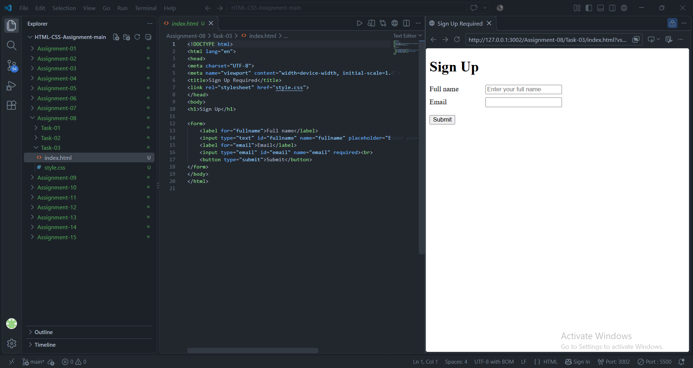

# STANDARD LAB PRACTICAL EXPERIMENT FORMAT
**INVERTIS UNIVERSITY, BAREILLY**  
**Faculty of Engineering & Technology**  
**B.Tech CSE - Section C | BCSAI111: HTML and CSS Introduction Lab**  
**Student Name:** Kartikeya Singh  
**Roll Number:** 2510303255

---

## EXPERIMENT NO. 08

### 1. Experiment Title:
Sign-Up Forms and Choices

### 2. Aim:
To construct interactive HTML web forms utilizing linked labels, various input types (text, email, password), choice controls (radio buttons, select dropdowns), and client-side form validation.

### 3. Software / Tools Required:
- **Web Browser:** Google Chrome / Microsoft Edge / Mozilla Firefox
- **Text Editor:** Visual Studio Code / Notepad

### 4. Theory:
- **HTML Forms (`<form>`):** Containers for user-input controls used to collect and submit data to a web server.
  - `action`: Destination URL where form data is sent.
  - `method`: HTTP transfer protocol (`post` sends data inside HTTP request body; `get` appends data to URL).
- **Form Controls:**
  - `type="text"`, `type="email"`, `type="password"` (masks characters).
  - `<label>`: Accessible description linked to an input via `for="id"`.
  - `type="radio"`: Mutually exclusive selections sharing the same `name` attribute.
  - `<select>` & `<option>`: Dropdown selection menu.
  - `required` & `placeholder`: Native HTML5 validation and user hints.

### 5. Algorithm / Procedure:
#### Task 1: Basic Sign-Up Form (`signup.html`)
1. Create `signup.html`.
2. Add `<form method="post" action="thanks.html">`.
3. Add input controls for Full Name, Email, and Password.
4. Link each `<label>` with its corresponding `<input>` using matching `for` and `id` attributes.

#### Task 2: Choice Controls (`choices.html`)
1. Create `choices.html`.
2. Implement two radio buttons for Gender (Female, Male) sharing `name="gender"`.
3. Implement a dropdown menu `<select name="course">` offering `BCA` and `B.Tech`.

#### Task 3: Required Fields & Submit Button (`signup-required.html`)
1. Create `signup-required.html`.
2. Add inputs for full name and email with the `required` boolean attribute.
3. Add `placeholder="Enter your full name"` to the name field.
4. Add a `<button type="submit">Submit</button>`.
5. Test validation by attempting to submit with empty inputs.

### 6. Program / Queries / Commands:

#### Task 1: `signup.html`
```html
<!DOCTYPE html>
<html lang="en">
<head>
    <meta charset="UTF-8">
    <meta name="viewport" content="width=device-width, initial-scale=1.0">
    <title>Sign Up</title>
</head>
<body>
    <h1>Student Sign-Up Form</h1>
    <form action="thanks.html" method="post">
        <div>
            <label for="fullname">Full Name:</label>
            <input type="text" id="fullname" name="fullname">
        </div>
        <br>
        <div>
            <label for="email">Email Address:</label>
            <input type="email" id="email" name="email">
        </div>
        <br>
        <div>
            <label for="password">Password:</label>
            <input type="password" id="password" name="password">
        </div>
        <br>
        <div>
            <button type="submit">Submit Registration</button>
        </div>
    </form>
</body>
</html>
```

#### Task 2: `choices.html`
```html
<!DOCTYPE html>
<html lang="en">
<head>
    <meta charset="UTF-8">
    <meta name="viewport" content="width=device-width, initial-scale=1.0">
    <title>Form Choices</title>
</head>
<body>
    <h1>Student Information Choices</h1>
    <form>
        <fieldset>
            <legend>Gender</legend>
            <input type="radio" id="female" name="gender" value="Female">
            <label for="female">Female</label>

            <input type="radio" id="male" name="gender" value="Male">
            <label for="male">Male</label>
        </fieldset>
        <br>
        <div>
            <label for="course">Select Course:</label>
            <select id="course" name="course">
                <option value="BCA">BCA</option>
                <option value="B.Tech">B.Tech</option>
            </select>
        </div>
    </form>
</body>
</html>
```

#### Task 3: `signup-required.html`
```html
<!DOCTYPE html>
<html lang="en">
<head>
    <meta charset="UTF-8">
    <meta name="viewport" content="width=device-width, initial-scale=1.0">
    <title>Sign Up - Required Fields</title>
</head>
<body>
    <h1>Registration Form (Required Fields)</h1>
    <form action="#" method="post">
        <div>
            <label for="fullName">Full Name:</label>
            <input type="text" id="fullName" name="fullName" placeholder="Enter your full name" required>
        </div>
        <br>
        <div>
            <label for="userEmail">Email Address:</label>
            <input type="email" id="userEmail" name="userEmail" required>
        </div>
        <br>
        <div>
            <button type="submit">Submit</button>
        </div>
    </form>
</body>
</html>
```

### 7. Input:
- Form fields: Name, Email, Password
- Radio selection: Gender (`Female` or `Male`)
- Dropdown choices: `BCA`, `B.Tech`

### 8. Output:
- **Task 1:** Form displaying three labelled text boxes; characters in the password field are masked with dots.

  

- **Task 2:** Radio buttons allowing only a single selection at a time, and a functional course dropdown.

  

- **Task 3:** Browser shows an automatic error prompt: *"Please fill out this field"* when submitting with empty required inputs.

  


### 9. Result:
Accessible, functional forms were created utilizing proper semantic input types, linked labels, mutually exclusive radio options, dropdown menus, and validation constraints.

### 10. Viva-Voce Questions:
1. **What is the difference between GET and POST methods?**  
   *Answer:* GET appends form data to the URL in query strings (visible in address bar, limited length), whereas POST sends data securely within the HTTP request body.
2. **Why must a `<label>` element have a `for` attribute matching an input's `id`?**  
   *Answer:* It links the label to the control for screen readers and allows clicking the label text to focus or toggle the input control.
3. **How do radio buttons enforce single-choice mutual exclusivity?**  
   *Answer:* By giving all radio buttons in the group the identical `name` attribute.
4. **What does the `required` attribute do?**  
   *Answer:* It enforces client-side browser validation, preventing form submission if the user leaves the input blank.
