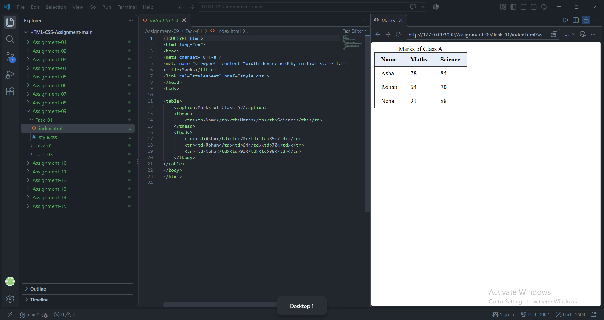
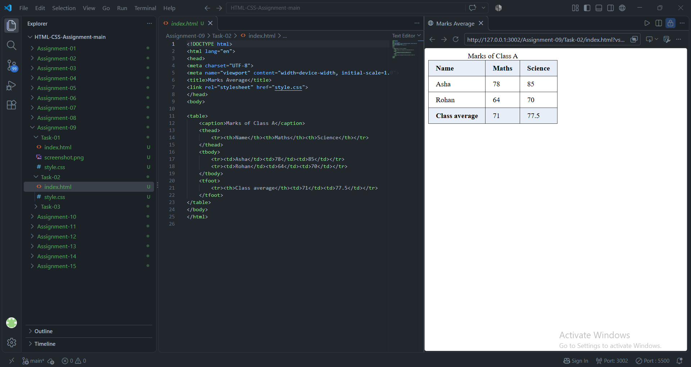
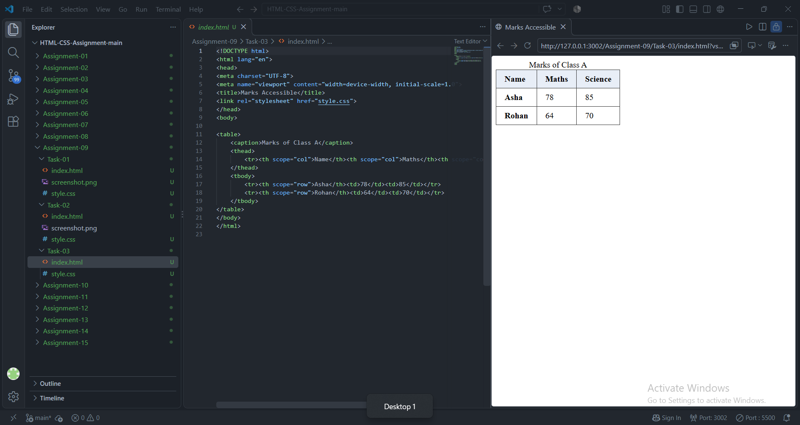

# STANDARD LAB PRACTICAL EXPERIMENT FORMAT
**INVERTIS UNIVERSITY, BAREILLY**  
**Faculty of Engineering & Technology**  
**B.Tech CSE - Section C | BCSAI111: HTML and CSS Introduction Lab**  
**Student Name:** Kartikeya Singh  
**Roll Number:** 2510303255

---

## EXPERIMENT NO. 09

### 1. Experiment Title:
Tables with Headers and Footers

### 2. Aim:
To design structured data tables using captions, headers (`<thead>`), body data (`<tbody>`), summary footers (`<tfoot>`), and enhance table accessibility with the `scope` attribute.

### 3. Software / Tools Required:
- **Web Browser:** Google Chrome / Microsoft Edge / Mozilla Firefox
- **Text Editor:** Visual Studio Code / Notepad

### 4. Theory:
- **HTML Table Structure:**
  - `<table>`: The wrapper for tabular data.
  - `<caption>`: Provides an accessible title/summary for the table.
  - `<thead>`: Groups header content (`<th>`).
  - `<tbody>`: Groups body data rows (`<tr>` and `<td>`).
  - `<tfoot>`: Groups summary/footer calculations.
- **Accessibility with `scope`:**
  - `scope="col"`: Declares that a header cell applies to the entire column below it.
  - `scope="row"`: Declares that a header cell applies to the entire row across it.

### 5. Algorithm / Procedure:
#### Task 1: Basic Table with Header & Body (`marks.html`)
1. Create `marks.html`.
2. Add `<table>` with `<caption>Marks of Class A</caption>`.
3. Construct `<thead>` containing columns: `Name`, `Maths`, `Science`.
4. Add `<tbody>` containing three student rows: Asha (78, 85), Rohan (64, 70), Neha (91, 88).

#### Task 2: Adding a Table Footer (`marks-average.html`)
1. Create `marks-average.html`.
2. Retain the caption and header from Task 1.
3. Include rows for Asha and Rohan.
4. Add `<tfoot>` containing a row `Class average` with average Maths: `71` and Science: `77.5`.

#### Task 3: Accessible Table with Scope (`marks-accessible.html`)
1. Create `marks-accessible.html`.
2. Add `scope="col"` to header cells: `<th scope="col">Name</th>`, etc.
3. Convert student name cells from `<td>` to `<th scope="row">`.
4. Inspect table accessibility in browser Developer Tools.

### 6. Program / Queries / Commands:

#### Task 1: `marks.html`
```html
<!DOCTYPE html>
<html lang="en">
<head>
    <meta charset="UTF-8">
    <meta name="viewport" content="width=device-width, initial-scale=1.0">
    <title>Marks Table</title>
    <style>
        table, th, td { border: 1px solid black; border-collapse: collapse; padding: 8px 12px; }
        caption { font-weight: bold; margin-bottom: 6px; }
    </style>
</head>
<body>
    <table>
        <caption>Marks of Class A</caption>
        <thead>
            <tr>
                <th>Name</th>
                <th>Maths</th>
                <th>Science</th>
            </tr>
        </thead>
        <tbody>
            <tr>
                <td>Asha</td>
                <td>78</td>
                <td>85</td>
            </tr>
            <tr>
                <td>Rohan</td>
                <td>64</td>
                <td>70</td>
            </tr>
            <tr>
                <td>Neha</td>
                <td>91</td>
                <td>88</td>
            </tr>
        </tbody>
    </table>
</body>
</html>
```

#### Task 2: `marks-average.html`
```html
<!DOCTYPE html>
<html lang="en">
<head>
    <meta charset="UTF-8">
    <meta name="viewport" content="width=device-width, initial-scale=1.0">
    <title>Marks with Class Average</title>
    <style>
        table, th, td { border: 1px solid black; border-collapse: collapse; padding: 8px 12px; }
        caption { font-weight: bold; margin-bottom: 6px; }
        tfoot { font-weight: bold; background-color: #f2f2f2; }
    </style>
</head>
<body>
    <table>
        <caption>Marks of Class A</caption>
        <thead>
            <tr>
                <th>Name</th>
                <th>Maths</th>
                <th>Science</th>
            </tr>
        </thead>
        <tbody>
            <tr>
                <td>Asha</td>
                <td>78</td>
                <td>85</td>
            </tr>
            <tr>
                <td>Rohan</td>
                <td>64</td>
                <td>70</td>
            </tr>
        </tbody>
        <tfoot>
            <tr>
                <td>Class average</td>
                <td>71</td>
                <td>77.5</td>
            </tr>
        </tfoot>
    </table>
</body>
</html>
```

#### Task 3: `marks-accessible.html`
```html
<!DOCTYPE html>
<html lang="en">
<head>
    <meta charset="UTF-8">
    <meta name="viewport" content="width=device-width, initial-scale=1.0">
    <title>Accessible Marks Table</title>
    <style>
        table, th, td { border: 1px solid black; border-collapse: collapse; padding: 8px 12px; }
        caption { font-weight: bold; margin-bottom: 6px; }
        th { background-color: #f7f9fa; }
    </style>
</head>
<body>
    <table>
        <caption>Marks of Class A</caption>
        <thead>
            <tr>
                <th scope="col">Name</th>
                <th scope="col">Maths</th>
                <th scope="col">Science</th>
            </tr>
        </thead>
        <tbody>
            <tr>
                <th scope="row">Asha</th>
                <td>78</td>
                <td>85</td>
            </tr>
            <tr>
                <th scope="row">Rohan</th>
                <td>64</td>
                <td>70</td>
            </tr>
        </tbody>
    </table>
</body>
</html>
```

### 7. Input:
- Student Scores: Asha (78, 85), Rohan (64, 70), Neha (91, 88)
- Averages: Maths = 71, Science = 77.5

### 8. Output:
- **Task 1:** A clean bordered table showing 3 student rows under header columns.

  

- **Task 2:** Table with summary footer displaying "Class average" with 71 and 77.5.

  

- **Task 3:** Accessible table structure identical in appearance, with `scope="col"` and `scope="row"` in markup.

  


### 9. Result:
Tabular marks data was properly formatted with semantic headers and footers, and accessible headers were implemented with scope attributes.

### 10. Viva-Voce Questions:
1. **What is the difference between `<th>` and `<td>`?**  
   *Answer:* `<th>` designates a table header cell (bold and centered by default), while `<td>` designates standard table data.
2. **What role does `<caption>` play in a table?**  
   *Answer:* It provides an accessible title summarizing the table's purpose, placed directly under the `<table>` opening tag.
3. **Why should developers use `scope="col"` and `scope="row"`?**  
   *Answer:* They explicitly correlate header cells to columns or rows, allowing screen readers to accurately pronounce headers when navigating cells.
4. **What does the CSS property `border-collapse: collapse;` do?**  
   *Answer:* It merges adjacent table borders into a single border line instead of rendering separated double borders.
