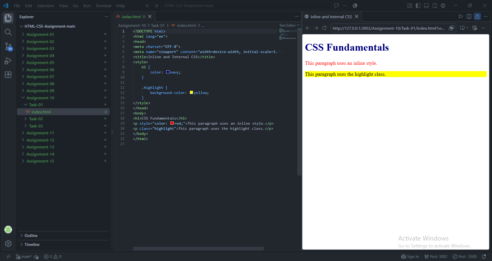
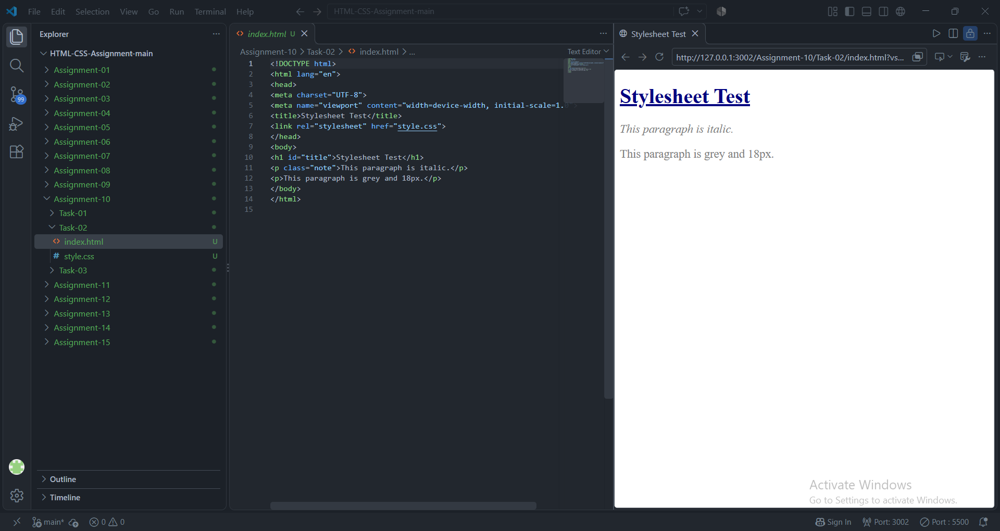
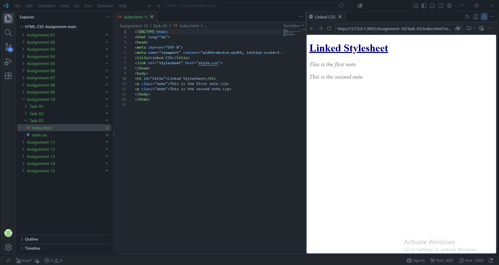

# STANDARD LAB PRACTICAL EXPERIMENT FORMAT
**INVERTIS UNIVERSITY, BAREILLY**  
**Faculty of Engineering & Technology**  
**B.Tech CSE - Section C | BCSAI111: HTML and CSS Introduction Lab**  
**Student Name:** Saiful Islam
**Roll Number:** 2510303448

---

## EXPERIMENT NO. 10

### 1. Experiment Title:
CSS Fundamentals

### 2. Aim:
To apply Cascading Style Sheets (CSS) through inline, internal, and external (linked) methods, and style text using element, class, and ID selectors.

### 3. Software / Tools Required:
- **Web Browser:** Google Chrome / Microsoft Edge / Mozilla Firefox
- **Text Editor:** Visual Studio Code / Notepad

### 4. Theory:
- **Methods of Applying CSS:**
  1. *Inline CSS:* Applied directly onto an element using the `style` attribute.
  2. *Internal CSS:* Declared inside a `<style>` block within the `<head>` section.
  3. *External CSS:* Defined in a standalone `.css` file and linked via `<link rel="stylesheet">`.
- **CSS Selectors:**
  - *Element Selector:* Targets all elements of a specified tag name (e.g. `h1`, `p`).
  - *Class Selector (`.`):* Targets elements possessing a specific class name (e.g. `.note`).
  - *ID Selector (`#`):* Targets a unique element possessing a specific ID (e.g. `#title`).
- **CSS Specificity:** Inline styles possess higher precedence over internal/external style rules.

### 5. Algorithm / Procedure:
#### Task 1: Inline and Internal CSS (`inline-internal.html`)
1. Create `inline-internal.html`.
2. Inside `<head>`, define `<style>` with `h1 { color: navy; }` and `.highlight { background-color: yellow; }`.
3. In `<body>`, insert an `<h1>`, a `<p>` with inline style `style="color: red;"`, and a `<p class="highlight">`.

#### Task 2: Creating External Stylesheet (`style.css`)
1. Create `style.css`.
2. Add rules:
   - `h1`: color navy
   - `.note`: font-style italic
   - `#title`: text-decoration underline
   - `p`: font-size 18px and color grey

#### Task 3: Linking External Stylesheet (`linked.html`)
1. Create `linked.html`.
2. In `<head>`, link `style.css` using `<link rel="stylesheet" href="style.css">`.
3. Add `<h1 id="title">...</h1>` and two paragraphs with `class="note"`.
4. Open in browser to confirm that external styles are applied.

### 6. Program / Queries / Commands:

#### Task 1: `inline-internal.html`
```html
<!DOCTYPE html>
<html lang="en">
<head>
    <meta charset="UTF-8">
    <meta name="viewport" content="width=device-width, initial-scale=1.0">
    <title>Inline and Internal CSS</title>
    <style>
        h1 {
            color: navy;
        }
        .highlight {
            background-color: yellow;
        }
    </style>
</head>
<body>
    <h1>Navy Colored Heading</h1>
    <p style="color: red;">This paragraph has an inline style making its text red.</p>
    <p class="highlight">This paragraph uses the class 'highlight' which gives it a yellow background.</p>
</body>
</html>
```

#### Task 2: `style.css`
```css
h1 {
    color: navy;
}

.note {
    font-style: italic;
}

#title {
    text-decoration: underline;
}

p {
    font-size: 18px;
    color: grey;
}
```

#### Task 3: `linked.html`
```html
<!DOCTYPE html>
<html lang="en">
<head>
    <meta charset="UTF-8">
    <meta name="viewport" content="width=device-width, initial-scale=1.0">
    <title>Linked External Stylesheet</title>
    <link rel="stylesheet" href="style.css">
</head>
<body>
    <h1 id="title">Web Development Lab Session</h1>
    <p class="note">Note 1: Always verify that external stylesheet links specify the accurate path and relation attribute.</p>
    <p class="note">Note 2: External CSS keeps HTML structure clean, modular, and maintainable across large sites.</p>
</body>
</html>
```

### 7. Input:
- CSS Rules & Selectors: `h1`, `.note`, `#title`, `p`, `.highlight`
- Text content for headings and notes

### 8. Output:
- **Task 1:** Navy heading, red inline paragraph, and yellow-highlighted paragraph.

  

- **Task 2 & 3:** Underlined navy title, and italicized 18px grey notes loaded from `style.css`.

  
  


### 9. Result:
All three CSS implementation methods were verified, and element, class, and ID selectors were successfully utilized.

### 10. Viva-Voce Questions:
1. **Name the three methods of attaching CSS to an HTML document.**  
   *Answer:* Inline CSS, Internal CSS, and External (Linked) CSS.
2. **Which method of CSS has the highest specificity/priority?**  
   *Answer:* Inline CSS overrides both internal and external CSS rules (unless `!important` is used).
3. **What is the syntax symbol used for class and ID selectors in CSS?**  
   *Answer:* A period (`.`) denotes a class selector, while a hash (`#`) denotes an ID selector.
4. **Why is external CSS preferred over inline styles in production?**  
   *Answer:* It maintains separation of concerns, allows caching by browsers, and enables styling an entire multi-page website from a single file.
