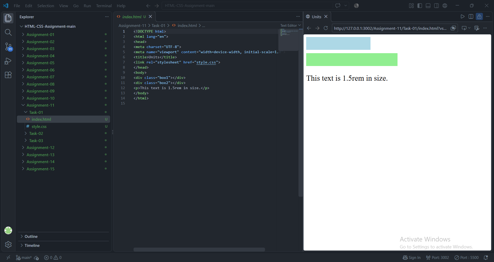
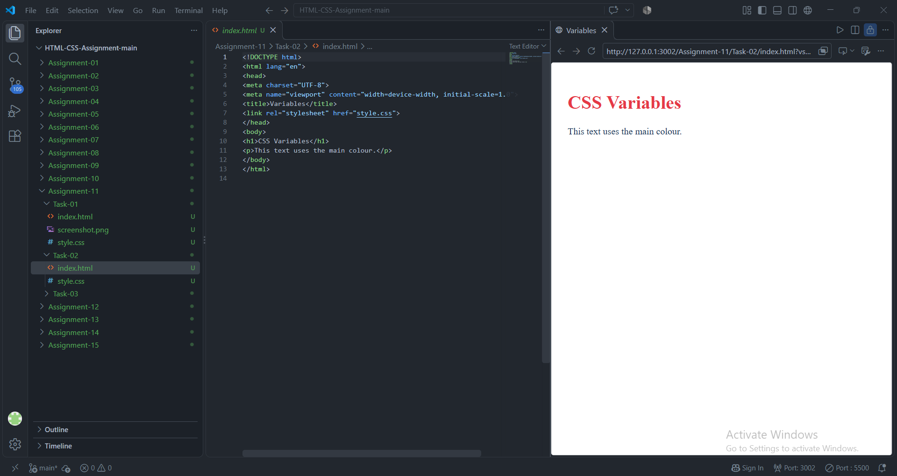

# STANDARD LAB PRACTICAL EXPERIMENT FORMAT
**INVERTIS UNIVERSITY, BAREILLY**  
**Faculty of Engineering & Technology**  
**B.Tech CSE - Section C | BCSAI111: HTML and CSS Introduction Lab**  
**Student Name:** Saiful Islam
**Roll Number:** 2510303448

---

## EXPERIMENT NO. 11

### 1. Experiment Title:
Units and CSS Variables

### 2. Aim:
To understand CSS measurement units (pixels, percentages, rem units) and store reusable colors, font sizes, and layout spacings in CSS variables (custom properties).

### 3. Software / Tools Required:
- **Web Browser:** Google Chrome / Microsoft Edge / Mozilla Firefox
- **Text Editor:** Visual Studio Code / Notepad

### 4. Theory:
- **Absolute vs Relative Units:**
  - `px` (Pixels): Absolute, fixed measurement unit.
  - `%` (Percentages): Relative to the parent element's dimensions.
  - `rem` (Root Em): Relative to the root `<html>` element's font size (typically `1rem = 16px`).
- **CSS Custom Properties (Variables):**
  - Declared using `--variable-name` syntax, commonly inside the `:root` pseudo-class for global scope.
  - Accessed using the `var(--variable-name)` function.
  - Allows easy theming, maintainability, and centralized design token management.

### 5. Algorithm / Procedure:
#### Task 1: CSS Units (`units.html`)
1. Create `units.html`.
2. Create a box with `width: 200px; height: 40px;` and background color.
3. Create a second box with `width: 50%; height: 40px;` and background color.
4. Add a paragraph with font size `1.5rem`.
5. Observe responsive behavior of the 50% box compared to the static 200px box.

#### Task 2: Internal CSS Variables (`variables.html`)
1. Create `variables.html`.
2. Define `--main-color: #1d3557;`, `--accent-color: #e63946;`, and `--page-padding: 20px;` in `:root`.
3. Apply `var(--main-color)` and `var(--page-padding)` to `body`, and `var(--accent-color)` to `h1`.

#### Task 3: Design Tokens in External CSS (`tokens.css` & `index.html`)
1. Create `tokens.css`.
2. Define variables for primary color (`#1d3557`), accent color (`#e63946`), heading size (`2rem`), and spacing (`16px`).
3. Apply variables to `body` and `h1`.
4. Link `tokens.css` into `index.html` to verify rendering.

### 6. Program / Queries / Commands:

#### Task 1: `units.html`
```html
<!DOCTYPE html>
<html lang="en">
<head>
    <meta charset="UTF-8">
    <meta name="viewport" content="width=device-width, initial-scale=1.0">
    <title>CSS Units Demonstration</title>
    <style>
        .box-px {
            width: 200px;
            height: 40px;
            background-color: #3498db;
            color: #ffffff;
            line-height: 40px;
            text-align: center;
            margin-bottom: 15px;
        }

        .box-percent {
            width: 50%;
            height: 40px;
            background-color: #2ecc71;
            color: #ffffff;
            line-height: 40px;
            text-align: center;
            margin-bottom: 15px;
        }

        .text-rem {
            font-size: 1.5rem;
            color: #2c3e50;
        }
    </style>
</head>
<body>
    <h1>CSS Units: Pixels, Percentages, and Rems</h1>
    <div class="box-px">200px Wide Box</div>
    <div class="box-percent">50% Wide Box</div>
    <p class="text-rem">This paragraph text is styled with a font size of 1.5rem.</p>
</body>
</html>
```

#### Task 2: `variables.html`
```html
<!DOCTYPE html>
<html lang="en">
<head>
    <meta charset="UTF-8">
    <meta name="viewport" content="width=device-width, initial-scale=1.0">
    <title>CSS Custom Properties (Variables)</title>
    <style>
        :root {
            --main-color: #1d3557;
            --accent-color: #e63946;
            --page-padding: 20px;
        }

        body {
            color: var(--main-color);
            padding: var(--page-padding);
            font-family: Arial, sans-serif;
            line-height: 1.6;
        }

        h1 {
            color: var(--accent-color);
        }
    </style>
</head>
<body>
    <h1>CSS Variables in Action</h1>
    <p>This paragraph text is colored using the main color variable (--main-color: #1d3557), while the page padding is set using the page padding variable (--page-padding: 20px). The heading above utilizes the accent color (--accent-color: #e63946).</p>
</body>
</html>
```

#### Task 3: `tokens.css`
```css
/* tokens.css */
:root {
    --primary-color: #1d3557;
    --accent-color: #e63946;
    --heading-size: 2rem;
    --spacing: 16px;
}

body {
    color: var(--primary-color);
    padding: var(--spacing);
    font-family: 'Segoe UI', Tahoma, Geneva, Verdana, sans-serif;
}

h1 {
    color: var(--accent-color);
    font-size: var(--heading-size);
}
```

#### Task 3: `index.html`
```html
<!DOCTYPE html>
<html lang="en">
<head>
    <meta charset="UTF-8">
    <meta name="viewport" content="width=device-width, initial-scale=1.0">
    <title>Design Tokens Demo</title>
    <link rel="stylesheet" href="tokens.css">
</head>
<body>
    <h1>Design Tokens with CSS Variables</h1>
    <p>All colors, font sizes, and layout spacings are dynamically controlled through the external tokens.css file.</p>
</body>
</html>
```

### 7. Input:
- CSS Unit values: `200px`, `50%`, `1.5rem`, `2rem`, `16px`
- CSS Color Tokens: `#1d3557` (Navy), `#e63946` (Crimson Accent)

### 8. Output:
- **Task 1:** A fixed 200px box, an adaptable 50% width box, and a prominent 1.5rem text paragraph.

  

- **Task 2:** Crimson heading and dark navy body text with 20px all-around padding governed by internal CSS variables.

  

- **Task 3:** Consistent page theming applied through external `tokens.css`.

  


### 9. Result:
CSS absolute and relative units were contrasted, and CSS variables were defined and referenced globally across documents.

### 10. Viva-Voce Questions:
1. **What is the difference between rem and em units?**  
   *Answer:* `rem` is relative only to the root `<html>` font size, whereas `em` is relative to its immediate parent element's font size (which can compound).
2. **What pseudo-class is used to declare global CSS variables?**  
   *Answer:* `:root`, which matches the highest-level element in the document tree (`<html>`).
3. **What is the syntax to access a CSS variable?**  
   *Answer:* The `var()` function: `color: var(--accent-color);`.
4. **Can fallback values be specified when reading a CSS variable?**  
   *Answer:* Yes, as a second parameter in `var()`: `var(--accent-color, #000000)`.
