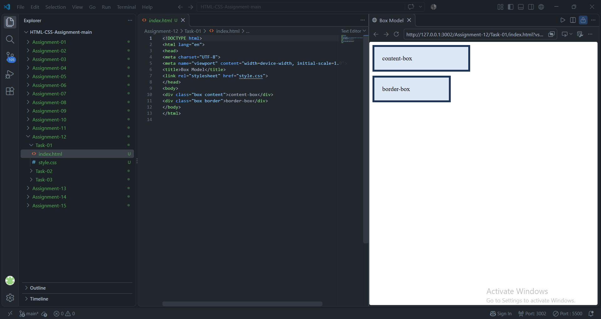
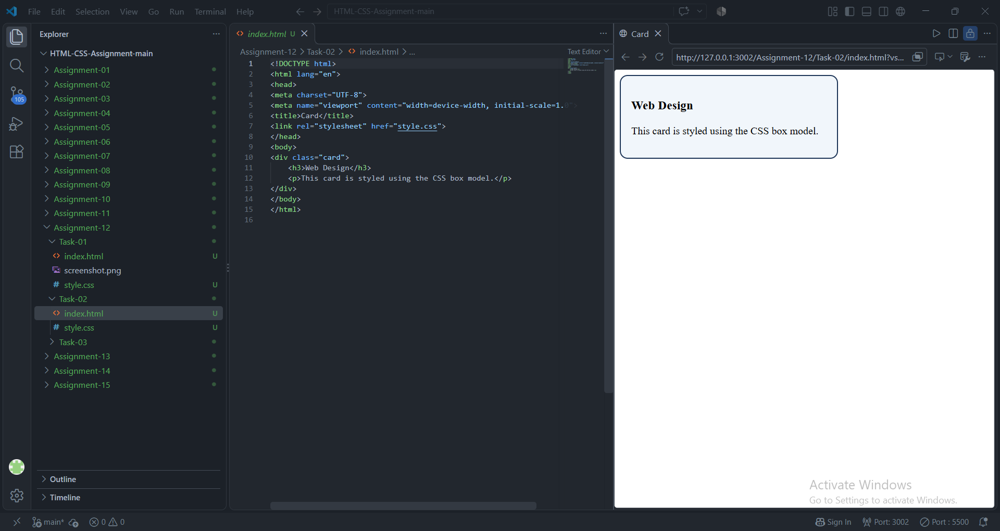
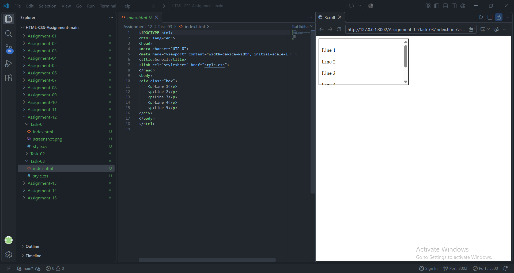

# STANDARD LAB PRACTICAL EXPERIMENT FORMAT
**INVERTIS UNIVERSITY, BAREILLY**  
**Faculty of Engineering & Technology**  
**B.Tech CSE - Section C | BCSAI111: HTML and CSS Introduction Lab**  
**Student Name:** Saiful Islam
**Roll Number:** 2510303448

---

## EXPERIMENT NO. 12

### 1. Experiment Title:
Box Model, Cards and Scrolling

### 2. Aim:
To compare CSS box-sizing behaviors (`content-box` vs `border-box`), construct a modern card UI component with rounded corners and borders, and manage overflow content with scrolling.

### 3. Software / Tools Required:
- **Web Browser:** Google Chrome / Microsoft Edge / Mozilla Firefox
- **Text Editor:** Visual Studio Code / Notepad

### 4. Theory:
- **CSS Box Model:** Every element is rendered as a rectangular box comprising:
  1. *Content:* The actual text or media.
  2. *Padding:* Transparent space between content and border.
  3. *Border:* Line surrounding the padding.
  4. *Margin:* Transparent space outside the border.
- **`box-sizing` Property:**
  - `content-box` (default): Total Width = width + padding-left + padding-right + border-left + border-right.
  - `border-box`: Total Width = width (padding and borders are absorbed within the defined width).
- **`overflow: auto;`:** Renders scrollbars only when the content exceeds the container's explicit dimensions.

### 5. Algorithm / Procedure:
#### Task 1: Box-Sizing Comparison (`box-model.html`)
1. Create `box-model.html`.
2. Define two boxes with identical dimensions: `width: 200px; padding: 20px; border: 5px solid;`.
3. Set `.box1` to `box-sizing: content-box;` (renders total width of 250px).
4. Set `.box2` to `box-sizing: border-box;` (renders total width of 200px).
5. Compare widths visually side by side.

#### Task 2: Card Component (`card.html`)
1. Create `card.html`.
2. Construct a `<div class="card">`.
3. Apply `background-color`, a 2px solid border, rounded corners with `border-radius: 12px;`, and `padding: 16px;`.
4. Insert an `<h3>` heading and paragraph text inside the card.

#### Task 3: Overflow Scrolling (`scroll.html`)
1. Create `scroll.html`.
2. Create a box with fixed `height: 120px; width: 300px;` and set `overflow: auto;`.
3. Insert 5 paragraphs (Line 1 to Line 5) inside the container.
4. Verify vertical scrollbar appearance in browser.

### 6. Program / Queries / Commands:

#### Task 1: `box-model.html`
```html
<!DOCTYPE html>
<html lang="en">
<head>
    <meta charset="UTF-8">
    <meta name="viewport" content="width=device-width, initial-scale=1.0">
    <title>CSS Box Model Comparison</title>
    <style>
        .box1 {
            width: 200px;
            padding: 20px;
            border: 5px solid #2980b9;
            box-sizing: content-box;
            background-color: #d4e6f1;
            margin-bottom: 25px;
        }

        .box2 {
            width: 200px;
            padding: 20px;
            border: 5px solid #27ae60;
            box-sizing: border-box;
            background-color: #d5f5e3;
        }
    </style>
</head>
<body>
    <h1>Box Sizing Comparison</h1>

    <h2>content-box (Total rendered width = 200 + 40 + 10 = 250px)</h2>
    <div class="box1">
        <strong>Box 1: content-box</strong><br>
        Width is applied only to the content area. Padding and border add onto it.
    </div>

    <h2>border-box (Total rendered width = 200px)</h2>
    <div class="box2">
        <strong>Box 2: border-box</strong><br>
        Width includes content, padding, and border.
    </div>
</body>
</html>
```

#### Task 2: `card.html`
```html
<!DOCTYPE html>
<html lang="en">
<head>
    <meta charset="UTF-8">
    <meta name="viewport" content="width=device-width, initial-scale=1.0">
    <title>Styled Card Component</title>
    <style>
        body {
            font-family: Arial, sans-serif;
            background-color: #f4f7f6;
            padding: 30px;
        }

        .card {
            background-color: #ffffff;
            border: 2px solid #3498db;
            border-radius: 12px;
            padding: 16px;
            max-width: 350px;
            box-shadow: 0 4px 6px rgba(0, 0, 0, 0.1);
        }

        .card h3 {
            margin-top: 0;
            color: #2c3e50;
        }

        .card p {
            margin-bottom: 0;
            color: #555555;
            line-height: 1.5;
        }
    </style>
</head>
<body>
    <h1>Card Component</h1>
    <div class="card">
        <h3>Web Development Workshop</h3>
        <p>Join us for an intensive hands-on session on HTML5 semantic tags, CSS styling techniques, and modern responsive layouts.</p>
    </div>
</body>
</html>
```

#### Task 3: `scroll.html`
```html
<!DOCTYPE html>
<html lang="en">
<head>
    <meta charset="UTF-8">
    <meta name="viewport" content="width=device-width, initial-scale=1.0">
    <title>Scrollable Box</title>
    <style>
        .scroll-container {
            height: 120px;
            overflow: auto;
            border: 2px solid #8e44ad;
            background-color: #f5eef8;
            padding: 10px 15px;
            width: 300px;
        }

        .scroll-container p {
            margin: 8px 0;
            padding: 6px;
            background-color: #ffffff;
            border-left: 3px solid #8e44ad;
        }
    </style>
</head>
<body>
    <h1>Overflow Scrolling Demonstration</h1>
    <div class="scroll-container">
        <p>Line 1: Introduction to computer science foundations.</p>
        <p>Line 2: Data structures and algorithm design.</p>
        <p>Line 3: Object-oriented programming in Java and C++.</p>
        <p>Line 4: Database management systems and SQL.</p>
        <p>Line 5: Web development using HTML, CSS, and JavaScript.</p>
    </div>
</body>
</html>
```

### 7. Input:
- Box dimensions: width 200px, padding 20px, border 5px
- Card properties: border-radius 12px, border 2px solid, padding 16px
- Scroll container: height 120px, overflow auto

### 8. Output:
- **Task 1:** Visual evidence that `content-box` expands to 250px total width, whereas `border-box` confines the element precisely to 200px.

  

- **Task 2:** A polished card component with soft curved borders and distinct internal spacing.

  

- **Task 3:** A scrollable panel displaying 5 lines within a 120px fixed vertical frame.

  


### 9. Result:
The impact of `box-sizing: border-box` was verified, modern card UI styling was accomplished, and dynamic overflow scrolling was implemented.

### 10. Viva-Voce Questions:
1. **Why is `box-sizing: border-box` preferred in modern web design?**  
   *Answer:* It makes responsive layout calculations predictable because padding and borders do not expand an element beyond its defined width or height.
2. **What is the difference between `overflow: scroll;` and `overflow: auto;`?**  
   *Answer:* `overflow: scroll` always displays scrollbar gutters (even when content fits), whereas `overflow: auto` only shows scrollbars when content actually overflows.
3. **What is the CSS syntax for applying rounded corners to only specific corners?**  
   *Answer:* Individual properties such as `border-top-left-radius` or shorthand `border-radius: top-left top-right bottom-right bottom-left;`.
4. **Does `margin` collapse vertically between adjacent block elements?**  
   *Answer:* Yes, vertical margins between adjacent in-flow block elements collapse into a single margin equal to the larger of the two.
