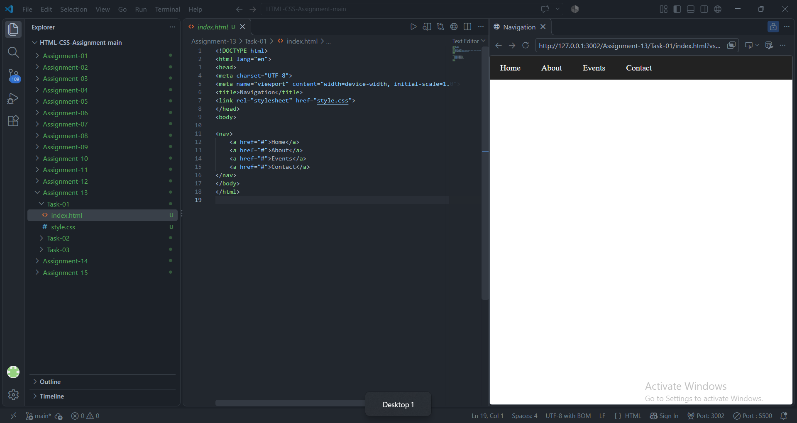
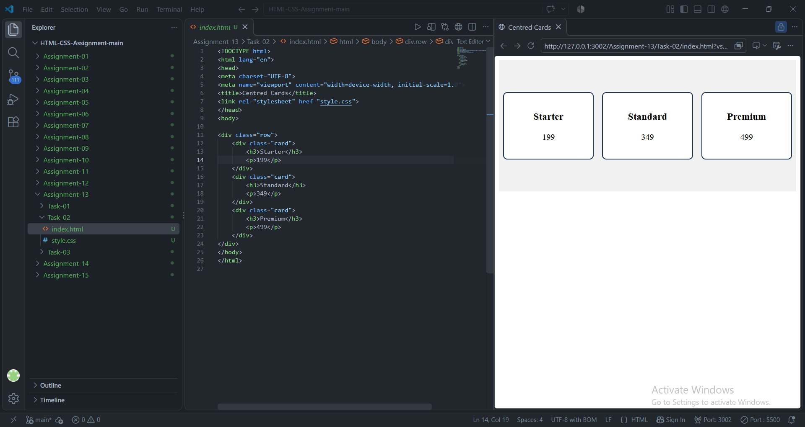
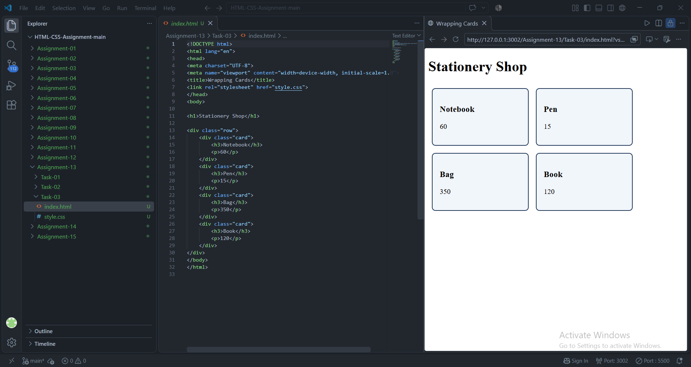

# STANDARD LAB PRACTICAL EXPERIMENT FORMAT
**INVERTIS UNIVERSITY, BAREILLY**  
**Faculty of Engineering & Technology**  
**B.Tech CSE - Section C | BCSAI111: HTML and CSS Introduction Lab**  
**Student Name:** Kartikeya Singh  
**Roll Number:** 2510303255

---

## EXPERIMENT NO. 13

### 1. Experiment Title:
Flexbox Layouts

### 2. Aim:
To implement CSS Flexible Box Layout (Flexbox) to build a responsive navigation bar, center items along main and cross axes, and manage responsive multi-line card wrapping.

### 3. Software / Tools Required:
- **Web Browser:** Google Chrome / Microsoft Edge / Mozilla Firefox
- **Text Editor:** Visual Studio Code / Notepad

### 4. Theory:
- **CSS Flexbox:** A 1D layout model providing powerful distribution of space and alignment of items along a main axis and a cross axis.
- **Key Flexbox Properties:**
  - `display: flex;`: Establishes the flex formatting context.
  - `flex-direction`: Sets main axis direction (`row` or `column`).
  - `justify-content`: Controls alignment along the main axis (`flex-start`, `center`, `space-between`, `space-around`, etc.).
  - `align-items`: Controls alignment along the cross axis (`stretch`, `center`, `flex-start`, `flex-end`, etc.).
  - `flex-wrap: wrap;`: Allows flex items to break into multiple lines rather than overflowing.
  - `gap`: Sets space between flex items cleanly without extra margins.

### 5. Algorithm / Procedure:
#### Task 1: Flexbox Navigation Bar (`nav-flex.html`)
1. Create `nav-flex.html`.
2. Create a `<nav>` with four links: Home, About, Events, Contact.
3. Apply `display: flex;` with dark background `#222222` and white links.
4. Add `gap` and `padding` for navigation spacing.

#### Task 2: Centered Cards in a Row (`centred-cards.html`)
1. Create `centred-cards.html`.
2. Create `<div class="row">` holding three pricing cards (Starter 199, Standard 349, Premium 499).
3. Set `.row` to `display: flex; justify-content: center; align-items: center; min-height: 350px;`.
4. Verify cards are centered both horizontally and vertically.

#### Task 3: Flex Wrap Cards (`wrapping-cards.html`)
1. Create `wrapping-cards.html`.
2. Add heading Stationery Shop.
3. Create four product cards: Notebook (60), Pen (15), Bag (350), Book (120).
4. Apply `display: flex; flex-wrap: wrap; gap: 16px;`.
5. Resize browser to observe cards wrapping into multiple rows.

### 6. Program / Queries / Commands:

#### Task 1: `nav-flex.html`
```html
<!DOCTYPE html>
<html lang="en">
<head>
    <meta charset="UTF-8">
    <meta name="viewport" content="width=device-width, initial-scale=1.0">
    <title>Flexbox Navigation Bar</title>
    <style>
        body {
            margin: 0;
            font-family: Arial, sans-serif;
        }

        nav {
            display: flex;
            background-color: #222222;
            padding: 14px 20px;
            gap: 25px;
        }

        nav a {
            color: #ffffff;
            text-decoration: none;
            font-size: 16px;
            font-weight: 500;
            transition: color 0.2s ease;
        }

        nav a:hover {
            color: #f39c12;
        }
    </style>
</head>
<body>
    <nav>
        <a href="#home">Home</a>
        <a href="#about">About</a>
        <a href="#events">Events</a>
        <a href="#contact">Contact</a>
    </nav>
    <main style="padding: 20px;">
        <h1>Flexbox Navigation Bar Demonstration</h1>
        <p>The navigation bar above uses <code>display: flex;</code> with a dark background and white link text.</p>
    </main>
</body>
</html>
```

#### Task 2: `centred-cards.html`
```html
<!DOCTYPE html>
<html lang="en">
<head>
    <meta charset="UTF-8">
    <meta name="viewport" content="width=device-width, initial-scale=1.0">
    <title>Centred Cards with Flexbox</title>
    <style>
        body {
            font-family: Arial, sans-serif;
            background-color: #f0f2f5;
            margin: 0;
            padding: 20px;
        }

        .row {
            display: flex;
            justify-content: center;
            align-items: center;
            gap: 20px;
            min-height: 350px;
            background-color: #e9ecef;
            border-radius: 8px;
            padding: 20px;
        }

        .card {
            background-color: #ffffff;
            border: 1px solid #ced4da;
            border-radius: 8px;
            padding: 24px;
            width: 180px;
            text-align: center;
            box-shadow: 0 4px 6px rgba(0,0,0,0.05);
        }

        .card h3 {
            margin-top: 0;
            color: #1d3557;
        }

        .card p {
            font-size: 24px;
            font-weight: bold;
            color: #e63946;
            margin: 10px 0 0;
        }
    </style>
</head>
<body>
    <h1 style="text-align: center;">Subscription Plans</h1>
    <div class="row">
        <div class="card">
            <h3>Starter</h3>
            <p>199</p>
        </div>
        <div class="card">
            <h3>Standard</h3>
            <p>349</p>
        </div>
        <div class="card">
            <h3>Premium</h3>
            <p>499</p>
        </div>
    </div>
</body>
</html>
```

#### Task 3: `wrapping-cards.html`
```html
<!DOCTYPE html>
<html lang="en">
<head>
    <meta charset="UTF-8">
    <meta name="viewport" content="width=device-width, initial-scale=1.0">
    <title>Stationery Shop - Flex Wrap</title>
    <style>
        body {
            font-family: Arial, sans-serif;
            padding: 20px;
            background-color: #fafafa;
        }

        .flex-container {
            display: flex;
            flex-wrap: wrap;
            gap: 16px;
        }

        .card {
            background-color: #ffffff;
            border: 1px solid #dddddd;
            border-radius: 8px;
            padding: 20px;
            width: 180px;
            box-shadow: 0 2px 4px rgba(0,0,0,0.06);
            box-sizing: border-box;
        }

        .card h3 {
            margin-top: 0;
            color: #2c3e50;
        }

        .price {
            font-size: 18px;
            font-weight: bold;
            color: #27ae60;
            margin-top: 10px;
        }
    </style>
</head>
<body>
    <h1>Stationery Shop</h1>
    <p>Resize or narrow the browser window to see items wrap onto the next row automatically.</p>

    <div class="flex-container">
        <div class="card">
            <h3>Notebook</h3>
            <div class="price">Price: 60</div>
        </div>
        <div class="card">
            <h3>Pen</h3>
            <div class="price">Price: 15</div>
        </div>
        <div class="card">
            <h3>Bag</h3>
            <div class="price">Price: 350</div>
        </div>
        <div class="card">
            <h3>Book</h3>
            <div class="price">Price: 120</div>
        </div>
    </div>
</body>
</html>
```

### 7. Input:
- Navigation bar items: Home, About, Events, Contact
- Pricing cards: Starter (199), Standard (349), Premium (499)
- Shop product items: Notebook (60), Pen (15), Bag (350), Book (120)

### 8. Output:
- **Task 1:** Sleek horizontal navigation bar with white links across a dark `#222222` banner.

  

- **Task 2:** Three subscription cards perfectly centered horizontally and vertically within a tinted container.

  

- **Task 3:** Responsive card deck that wraps onto subsequent lines as viewport dimensions shrink.

  


### 9. Result:
Flexbox layouts were successfully implemented, demonstrating directional flow, 2-axis alignment, and responsive wrapping.

### 10. Viva-Voce Questions:
1. **What is the difference between `justify-content` and `align-items` in Flexbox?**  
   *Answer:* `justify-content` aligns items along the main axis, while `align-items` aligns items along the cross axis.
2. **What does `flex: 1;` shorthand represent?**  
   *Answer:* It expands to `flex-grow: 1; flex-shrink: 1; flex-basis: 0%;`, allowing flex items to grow and shrink equally to occupy available space.
3. **What is the default value of `flex-direction`?**  
   *Answer:* `row`.
4. **How does `flex-wrap: wrap;` prevent overflow in responsive designs?**  
   *Answer:* It directs flex items that exceed container width to break cleanly onto new rows rather than clipping or shrinking below minimum limits.
