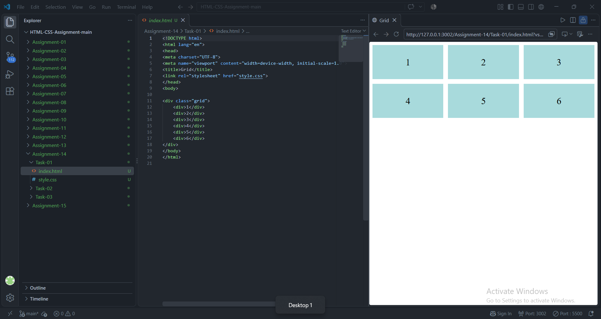
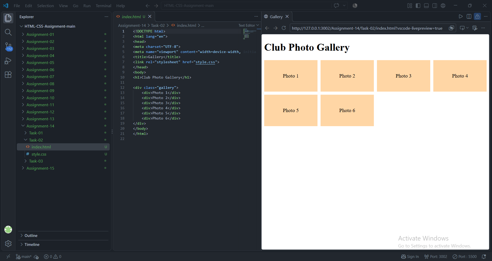
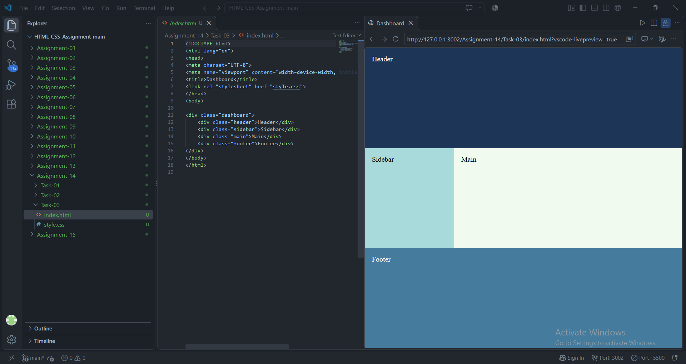

# STANDARD LAB PRACTICAL EXPERIMENT FORMAT
**INVERTIS UNIVERSITY, BAREILLY**  
**Faculty of Engineering & Technology**  
**B.Tech CSE - Section C | BCSAI111: HTML and CSS Introduction Lab**  
**Student Name:** Kartikeya Singh  
**Roll Number:** 2510303255

---

## EXPERIMENT NO. 14

### 1. Experiment Title:
CSS Grid Layouts

### 2. Aim:
To implement two-dimensional layouts using CSS Grid, construct equal fractional columns, build an auto-filling responsive gallery, and design an application dashboard using named grid areas.

### 3. Software / Tools Required:
- **Web Browser:** Google Chrome / Microsoft Edge / Mozilla Firefox
- **Text Editor:** Visual Studio Code / Notepad

### 4. Theory:
- **CSS Grid:** A powerful 2-dimensional layout system that handles both rows and columns simultaneously.
- **Key Concepts:**
  - `fr` unit: Represents a fraction of the available free space in the grid container.
  - `repeat(n, size)`: Repeats grid track sizing definitions.
  - `repeat(auto-fill, minmax(min, max))`: Dynamically fills rows with as many columns as will fit without requiring media queries.
  - `grid-template-areas`: Defines named grid areas visually mapping HTML components to structural layout slots.

### 5. Algorithm / Procedure:
#### Task 1: Equal Columns Grid (`grid-first.html`)
1. Create `grid-first.html`.
2. Create 6 numbered boxes (1 to 6).
3. Set container to `display: grid; grid-template-columns: 1fr 1fr 1fr; gap: 12px;`.
4. Verify 2 rows of 3 equal columns.

#### Task 2: Responsive Gallery (`gallery.html`)
1. Create `gallery.html` with heading Club Photo Gallery.
2. Add 6 gallery boxes labelled Photo 1 to Photo 6.
3. Configure `grid-template-columns: repeat(auto-fill, minmax(150px, 1fr)); gap: 10px;`.
4. Resize window to observe columns reflowing automatically.

#### Task 3: Dashboard with Named Areas (`dashboard-areas.html`)
1. Create `dashboard-areas.html`.
2. Create elements: `<header>`, `<aside>` (sidebar), `<main>`, `<footer>`.
3. Define grid:
   ```css
   grid-template-columns: 200px 1fr;
   grid-template-areas:
       "header  header"
       "sidebar main"
       "footer  footer";
   ```
4. Assign respective `grid-area` properties to each semantic element.

### 6. Program / Queries / Commands:

#### Task 1: `grid-first.html`
```html
<!DOCTYPE html>
<html lang="en">
<head>
    <meta charset="UTF-8">
    <meta name="viewport" content="width=device-width, initial-scale=1.0">
    <title>CSS Grid - Equal Columns</title>
    <style>
        body {
            font-family: Arial, sans-serif;
            padding: 20px;
        }

        .grid-container {
            display: grid;
            grid-template-columns: 1fr 1fr 1fr;
            gap: 12px;
        }

        .box {
            background-color: #3498db;
            color: #ffffff;
            font-size: 28px;
            font-weight: bold;
            display: flex;
            justify-content: center;
            align-items: center;
            height: 100px;
            border-radius: 6px;
        }
    </style>
</head>
<body>
    <h1>CSS Grid: 3 Equal Columns (1fr 1fr 1fr) with 12px Gap</h1>
    <div class="grid-container">
        <div class="box">1</div>
        <div class="box">2</div>
        <div class="box">3</div>
        <div class="box">4</div>
        <div class="box">5</div>
        <div class="box">6</div>
    </div>
</body>
</html>
```

#### Task 2: `gallery.html`
```html
<!DOCTYPE html>
<html lang="en">
<head>
    <meta charset="UTF-8">
    <meta name="viewport" content="width=device-width, initial-scale=1.0">
    <title>Club Photo Gallery</title>
    <style>
        body {
            font-family: Arial, sans-serif;
            padding: 20px;
            background-color: #fdfefe;
        }

        .gallery-grid {
            display: grid;
            grid-template-columns: repeat(auto-fill, minmax(150px, 1fr));
            gap: 10px;
        }

        .gallery-box {
            background-color: #16a085;
            color: #ffffff;
            height: 140px;
            border-radius: 6px;
            display: flex;
            align-items: center;
            justify-content: center;
            font-weight: bold;
            font-size: 18px;
            box-shadow: 0 2px 4px rgba(0,0,0,0.1);
        }
    </style>
</head>
<body>
    <h1>Club Photo Gallery</h1>
    <p>Resize your browser window wider or narrower to observe auto-filling columns (minmax 150px to 1fr).</p>

    <div class="gallery-grid">
        <div class="gallery-box">Photo 1</div>
        <div class="gallery-box">Photo 2</div>
        <div class="gallery-box">Photo 3</div>
        <div class="gallery-box">Photo 4</div>
        <div class="gallery-box">Photo 5</div>
        <div class="gallery-box">Photo 6</div>
    </div>
</body>
</html>
```

#### Task 3: `dashboard-areas.html`
```html
<!DOCTYPE html>
<html lang="en">
<head>
    <meta charset="UTF-8">
    <meta name="viewport" content="width=device-width, initial-scale=1.0">
    <title>Dashboard Grid Named Areas</title>
    <style>
        body {
            font-family: Arial, sans-serif;
            margin: 0;
            padding: 20px;
            background-color: #f4f6f7;
        }

        .dashboard-container {
            display: grid;
            grid-template-columns: 200px 1fr;
            grid-template-rows: auto 1fr auto;
            grid-template-areas:
                "header  header"
                "sidebar main"
                "footer  footer";
            gap: 12px;
            min-height: 480px;
        }

        header {
            grid-area: header;
            background-color: #2c3e50;
            color: #ffffff;
            padding: 18px;
            border-radius: 6px;
        }

        aside {
            grid-area: sidebar;
            background-color: #34495e;
            color: #ecf0f1;
            padding: 20px;
            border-radius: 6px;
        }

        main {
            grid-area: main;
            background-color: #ffffff;
            padding: 25px;
            border-radius: 6px;
            border: 1px solid #d5dbdb;
        }

        footer {
            grid-area: footer;
            background-color: #7f8c8d;
            color: #ffffff;
            padding: 14px;
            text-align: center;
            border-radius: 6px;
        }
    </style>
</head>
<body>
    <div class="dashboard-container">
        <header>
            <h2 style="margin: 0;">Student Portal Dashboard Header</h2>
        </header>

        <aside>
            <h3 style="margin-top: 0;">Sidebar Navigation</h3>
            <p>&bull; Overview</p>
            <p>&bull; Courses</p>
            <p>&bull; Attendance</p>
            <p>&bull; Marks</p>
        </aside>

        <main>
            <h2 style="margin-top: 0;">Main Content Area</h2>
            <p>This layout uses CSS Grid named template areas: <code>grid-template-areas: "header header" "sidebar main" "footer footer";</code>.</p>
            <p>The sidebar spans the left 200px column while the main content area occupies the flexible 1fr remaining space.</p>
        </main>

        <footer>
            <p style="margin: 0;">&copy; 2026 Invertis University Bareilly - Dashboard Footer</p>
        </footer>
    </div>
</body>
</html>
```

### 7. Input:
- Grid specifications: `1fr 1fr 1fr` columns with `12px` gap
- Gallery criteria: `repeat(auto-fill, minmax(150px, 1fr))` with `10px` gap
- Dashboard areas: `"header header" "sidebar main" "footer footer"` with `200px 1fr` track sizing

### 8. Output:
- **Task 1:** 6 blue blocks structured into 2 rows of 3 equal columns.

  

- **Task 2:** Smooth fluid grid where items rearrange dynamically based on viewport width.

  

- **Task 3:** Full application shell featuring persistent full-width header/footer and two-column sidebar/main content body.

  


### 9. Result:
Two-dimensional CSS Grid layouts were developed, achieving intrinsic responsiveness and structured named area mapping.

### 10. Viva-Voce Questions:
1. **What is the fundamental difference between Flexbox and CSS Grid?**  
   *Answer:* Flexbox is primarily one-dimensional (row OR column), whereas CSS Grid is two-dimensional (handling rows AND columns simultaneously).
2. **What does the `1fr` unit mean in CSS Grid?**  
   *Answer:* One fraction of the available remaining space in the grid container after fixed dimensions and gaps are deducted.
3. **How does `repeat(auto-fill, minmax(150px, 1fr))` achieve responsiveness without media queries?**  
   *Answer:* It calculates how many columns of at least 150px fit into the current container width, automatically creating and wrapping tracks without requiring explicit breakpoint rules.
4. **How are empty cells represented in `grid-template-areas`?**  
   *Answer:* Using a dot/period character (`"."`).
