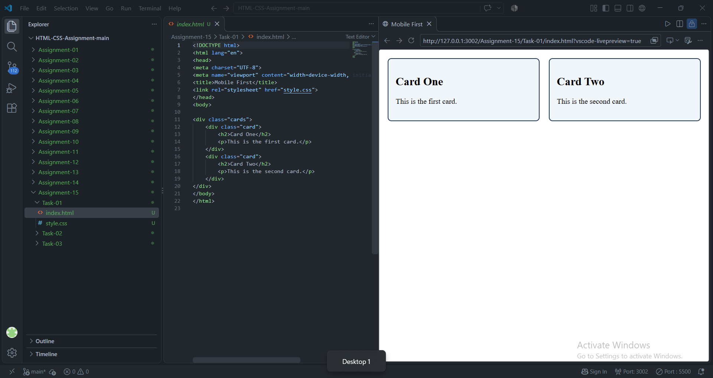
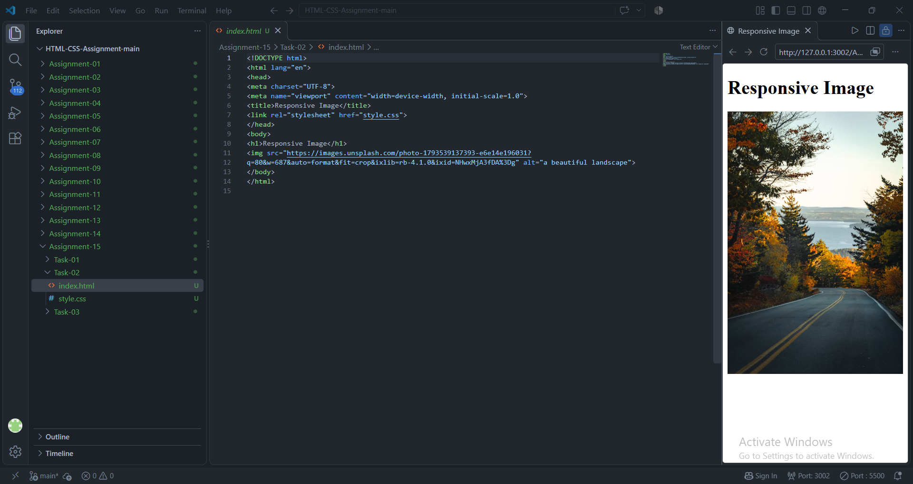
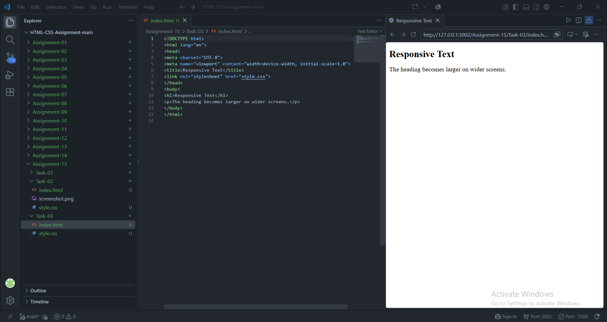

# STANDARD LAB PRACTICAL EXPERIMENT FORMAT
**INVERTIS UNIVERSITY, BAREILLY**  
**Faculty of Engineering & Technology**  
**B.Tech CSE - Section C | BCSAI111: HTML and CSS Introduction Lab**  
**Student Name:** Kartikeya Singh  
**Roll Number:** 2510303255

---

## EXPERIMENT NO. 15

### 1. Experiment Title:
Responsive Pages with Media Queries

### 2. Aim:
To apply mobile-first responsive design principles using CSS media queries (`@media`), create fluid scalable images, and implement responsive typography with `rem` units.

### 3. Software / Tools Required:
- **Web Browser:** Google Chrome / Microsoft Edge / Mozilla Firefox (with DevTools Device Toolbar)
- **Text Editor:** Visual Studio Code / Notepad
- **Image File:** JPEG photo asset

### 4. Theory:
- **Responsive Web Design (RWD):** Approach aimed at making web pages render well on a variety of devices and window or screen sizes.
- **Viewport Meta Tag:**
  `<meta name="viewport" content="width=device-width, initial-scale=1.0">`
  Instructs mobile browsers to set screen width equal to device width rather than zooming out to desktop scale.
- **Mobile-First Approach:** Base styles are designed for mobile viewports, and `@media (min-width: ...)` queries add enhancements as screen width expands.
- **Fluid Images:** `max-width: 100%; height: auto;` ensures images scale down proportionally within their containers without pixel distortion or overflow.
- **Responsive Typography:** Scaling text font size based on media query breakpoints using `rem` units.

### 5. Algorithm / Procedure:
#### Task 1: Mobile-First Responsive Cards (`mobile-first.html`)
1. Create `mobile-first.html`.
2. Add viewport meta tag inside `<head>`.
3. Create container `<div class="cards">` with two `.card` items.
4. Write base styles: `.cards { display: flex; flex-direction: column; gap: 16px; }`.
5. Add media query:
   ```css
   @media (min-width: 600px) {
       .cards { flex-direction: row; }
       .card { flex: 1; }
   }
   ```
6. Test in browser using Toggle Device Toolbar (F12) across mobile and desktop widths.

#### Task 2: Responsive Fluid Image (`responsive-image.html`)
1. Create `responsive-image.html`.
2. Embed image `images/responsive-demo.jpg`.
3. Apply CSS: `img { max-width: 100%; height: auto; display: block; }`.
4. Wrap inside `.image-wrapper` with `max-width: 650px;`.
5. Resize browser to confirm the image scales down smoothly.

#### Task 3: Responsive Typography (`responsive-text.html`)
1. Create `responsive-text.html`.
2. Set base font sizes: `body { font-size: 1rem; }`, `h1 { font-size: 1.5rem; }`.
3. Add media query:
   ```css
   @media (min-width: 600px) {
       h1 { font-size: 2.5rem; }
   }
   ```
4. Verify typography scaling at the 600px breakpoint.

### 6. Program / Queries / Commands:

#### Task 1: `mobile-first.html`
```html
<!DOCTYPE html>
<html lang="en">
<head>
    <meta charset="UTF-8">
    <meta name="viewport" content="width=device-width, initial-scale=1.0">
    <title>Mobile First Responsive Cards</title>
    <style>
        body {
            font-family: Arial, sans-serif;
            background-color: #f7f9fa;
            padding: 20px;
            margin: 0;
        }

        /* Mobile base styles (stacked vertically) */
        .cards {
            display: flex;
            flex-direction: column;
            gap: 16px;
        }

        .card {
            background-color: #ffffff;
            border: 1px solid #dcdde1;
            border-radius: 8px;
            padding: 16px;
            box-shadow: 0 2px 4px rgba(0,0,0,0.05);
        }

        .card h2 {
            margin-top: 0;
            color: #2f3640;
        }

        /* Media query for screens 600px wide and up (side by side) */
        @media (min-width: 600px) {
            .cards {
                flex-direction: row;
            }

            .card {
                flex: 1;
            }
        }
    </style>
</head>
<body>
    <h1>Mobile-First Card Layout</h1>
    <p>On mobile phones (&lt; 600px), these cards stack vertically. At 600px and up, they sit side-by-side.</p>

    <div class="cards">
        <div class="card">
            <h2>Front-End Basics</h2>
            <p>Master HTML5 structure and semantics, CSS selectors, box model principles, and modern layout systems.</p>
        </div>
        <div class="card">
            <h2>Responsive Design</h2>
            <p>Leverage flexible units, fluid media, and CSS media queries to build adaptable multi-device experiences.</p>
        </div>
    </div>
</body>
</html>
```

#### Task 2: `responsive-image.html`
```html
<!DOCTYPE html>
<html lang="en">
<head>
    <meta charset="UTF-8">
    <meta name="viewport" content="width=device-width, initial-scale=1.0">
    <title>Responsive Image Scaling</title>
    <style>
        body {
            font-family: Arial, sans-serif;
            padding: 20px;
            background-color: #f8f9fa;
        }

        /* Responsive image rules */
        img {
            max-width: 100%;
            height: auto;
            display: block;
            border-radius: 8px;
            box-shadow: 0 4px 8px rgba(0,0,0,0.12);
        }

        .image-wrapper {
            max-width: 650px;
            margin-top: 20px;
        }
    </style>
</head>
<body>
    <h1>Invertis Campus Scenic View</h1>
    <p>Resize your browser window to see how the image scales smoothly without overflowing its container.</p>

    <div class="image-wrapper">
        
    </div>
</body>
</html>
```

#### Task 3: `responsive-text.html`
```html
<!DOCTYPE html>
<html lang="en">
<head>
    <meta charset="UTF-8">
    <meta name="viewport" content="width=device-width, initial-scale=1.0">
    <title>Responsive Typography with Rem Units</title>
    <style>
        body {
            font-family: Arial, sans-serif;
            font-size: 1rem;
            line-height: 1.6;
            padding: 20px;
            color: #333333;
        }

        h1 {
            font-size: 1.5rem;
            color: #1a5276;
            transition: font-size 0.3s ease;
        }

        /* Media query for screens 600px wide and up */
        @media (min-width: 600px) {
            h1 {
                font-size: 2.5rem;
            }
        }
    </style>
</head>
<body>
    <h1>Responsive Heading Scaling</h1>
    <p>On screens narrower than 600px, this H1 heading is set to 1.5rem and the body font size is 1rem. When the browser viewport reaches 600px or wider, the media query smoothly increases the H1 heading to 2.5rem.</p>
</body>
</html>
```

### 7. Input:
- Media query breakpoint: `(min-width: 600px)`
- Fluid image dimensions: `max-width: 100%; height: auto;`
- Responsive text scale: `1rem` body base, `1.5rem` mobile heading scaling to `2.5rem` desktop heading

### 8. Output:
- **Task 1:** Mobile-first column stack transitioning dynamically into a two-column card row past 600px.

  

- **Task 2:** Campus image maintaining aspect ratio and scaling down seamlessly within narrower viewports.

  

- **Task 3:** Fluid heading enlarging gracefully from 24px (1.5rem) to 40px (2.5rem) at the desktop threshold.

  


### 9. Result:
Mobile-first responsive design was implemented using viewport configuration, CSS media queries, fluid imagery, and adaptive typography.

### 10. Viva-Voce Questions:
1. **What is the significance of `<meta name="viewport" content="width=device-width, initial-scale=1.0">`?**  
   *Answer:* It tells mobile browsers to render the document at the device's actual pixel width rather than emulating a 980px desktop screen and downscaling.
2. **What is mobile-first design and why is it recommended?**  
   *Answer:* Designing the base CSS layout for small mobile screens first and progressively adding layout complexity via `min-width` media queries for larger viewports. It results in leaner code and faster performance on mobile devices.
3. **How does `max-width: 100%; height: auto;` create fluid images?**  
   *Answer:* `max-width: 100%` prevents the image from exceeding its parent's width while allowing it to shrink, and `height: auto` ensures the original aspect ratio is preserved without distortion.
4. **What is the difference between `min-width` and `max-width` in media queries?**  
   *Answer:* `min-width` applies styles when the viewport is at least that wide (mobile-first), whereas `max-width` applies styles when the viewport is at most that wide (desktop-down).
